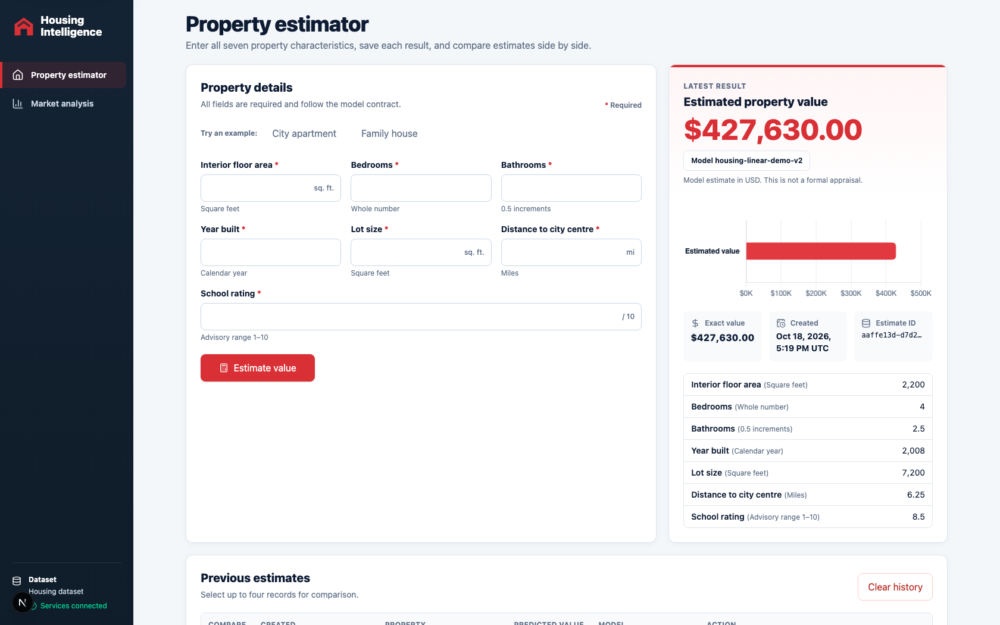
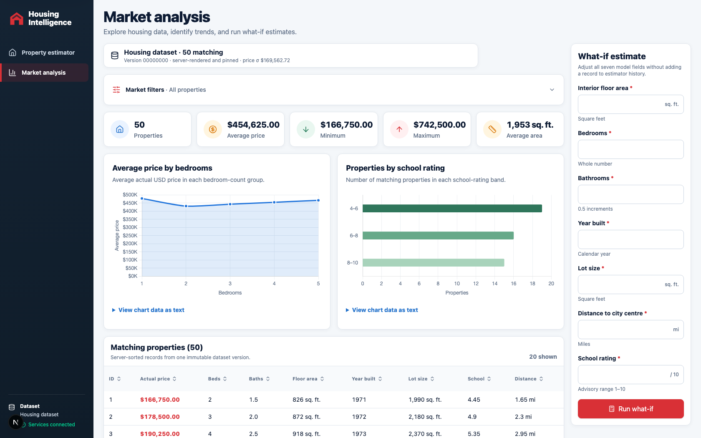
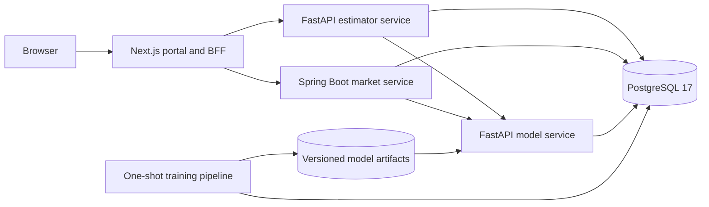

# Housing Intelligence Portal

## Overview

Housing Intelligence Portal implements the two assignments in
[`requirements/Interview Tasks Fullstack.pdf`](requirements/Interview%20Tasks%20Fullstack.pdf):

- a Python/FastAPI housing-price model API with deterministic training, model metadata, batch
  prediction, and PostgreSQL-backed model registration;
- a Next.js portal containing a durable Property Value Estimator and a Spring Boot Property Market
  Analysis application.

The market application queries the live business dataset and provides statistics, charts, filters,
revision-bound cursor pagination, model-backed what-if estimates, and asynchronous CSV/PDF
downloads. Training freezes immutable dataset versions from that live store for reproducible model
lineage. The entire stack runs with Docker Compose; the portal, model API, and Java Swagger UI are
published to loopback by default.

## Current Screenshots

### Property Value Estimator



### Property Market Analysis



## Quick Start

The application requires Git, Make, Docker Engine, and Docker Compose v2. Python, Java, Maven,
PostgreSQL, Flyway, Node.js, and the training runtime execute inside containers.

### macOS

Install the Apple command-line tools, then install and start
[Docker Desktop for Mac](https://docs.docker.com/desktop/setup/install/mac-install/). Docker Desktop
includes Docker Engine and Docker Compose.

```sh
xcode-select --install

# Install Homebrew if it is not already available.
/bin/bash -c "$(curl -fsSL https://raw.githubusercontent.com/Homebrew/install/HEAD/install.sh)"

brew install --cask docker
open -a Docker
```

Wait until Docker Desktop reports that the engine is running, then verify the command-line tools:

```sh
git --version
make --version
docker version
docker compose version
```

### Linux example: Ubuntu 22.04 or 24.04

Install Git and Make, then configure Docker's official APT repository and install Docker Engine with
the Compose plugin. Other distributions should follow the matching
[Docker Engine installation guide](https://docs.docker.com/engine/install/).

```sh
sudo apt-get update
sudo apt-get install -y ca-certificates curl git make

sudo install -m 0755 -d /etc/apt/keyrings
sudo curl -fsSL https://download.docker.com/linux/ubuntu/gpg \
  -o /etc/apt/keyrings/docker.asc
sudo chmod a+r /etc/apt/keyrings/docker.asc

sudo tee /etc/apt/sources.list.d/docker.sources >/dev/null <<EOF
Types: deb
URIs: https://download.docker.com/linux/ubuntu
Suites: $(. /etc/os-release && echo "${UBUNTU_CODENAME:-$VERSION_CODENAME}")
Components: stable
Architectures: $(dpkg --print-architecture)
Signed-By: /etc/apt/keyrings/docker.asc
EOF

sudo apt-get update
sudo apt-get install -y docker-ce docker-ce-cli containerd.io \
  docker-buildx-plugin docker-compose-plugin
sudo usermod -aG docker "$USER"
newgrp docker

docker version
docker compose version
```

### Clone and start the complete stack

Run these commands on either macOS or Linux:

```sh
git clone https://github.com/ChenhuaFan/house-price-estimator.git
cd house-price-estimator

cp .env.example .env
${EDITOR:-vi} .env
```

Replace every `change-*` value in `.env` with a local secret. Keep
`PUBLISH_HOST=127.0.0.1` unless access from another trusted device is intentional. Then bootstrap
the database, train and activate the initial model, build all services, start the stack, and run the
smoke checks:

```sh
make bootstrap
docker compose ps
```

Open:

- portal: <http://127.0.0.1:3000>
- Property Value Estimator: <http://127.0.0.1:3000/estimator>
- Property Market Analysis: <http://127.0.0.1:3000/market>
- model API Swagger UI: <http://127.0.0.1:8000/docs>
- Java market API Swagger UI: <http://127.0.0.1:8080/swagger-ui/index.html>

Stop the stack without deleting its named volumes:

```sh
make down
```

## Architecture



The portal is the browser-facing boundary and proxies requests to private application services. The
estimator owns idempotent estimates and anonymous history. The market service owns property queries,
statistics, signed cursors, what-if orchestration, and durable export jobs. The model service owns
validated inference and active-model metadata. PostgreSQL stores the mutable business records,
immutable training datasets, model registry state, estimate history, and export job state.

The Java service is one Maven/Spring Boot application with a strict internal dependency flow:

```text
generated OpenAPI interface
        -> Controller
        -> Service (@Transactional)
        -> @Repository DAO
        -> @Mapper interface
        -> Mapper XML
        -> PostgreSQL
```

Interactive queries and export-job state use a short-timeout query pool. Long-running export reads
use a separate export pool so report generation cannot exhaust interactive capacity. Detailed design
decisions are recorded in [`docs/architecture.md`](docs/architecture.md) and
[`docs/spring-boot-technical-design.md`](docs/spring-boot-technical-design.md).

## Repository Structure

```text
.
├── web-portal/          Next.js App Router UI and backend-for-frontend routes
├── model-service/       FastAPI prediction and model-metadata API
├── estimator-service/   FastAPI estimate workflow, idempotency, and history
├── market-service/      Single Spring Boot/Maven market API and export worker
│   └── src/main/
│       ├── java/com/hsbc/market/
│       │   ├── controller/   Generated-contract HTTP implementations
│       │   ├── service/      Business workflows and transaction boundaries
│       │   ├── dao/          Repository-level persistence operations
│       │   ├── mapper/       MyBatis interfaces for query and export pools
│       │   ├── model/        Domain, persistence, query, and v1 models
│       │   ├── export/       CSV/PDF generation and artifact storage
│       │   ├── client/       Model-service client
│       │   └── config/       Data sources, caching, scheduling, and health
│       └── resources/mapper/ MyBatis SQL XML
├── training/            Dataset export, training, evaluation, and publication
├── database/migrations/ Flyway schemas, roles, tables, and seed data
├── contracts/openapi/   Reviewed service contract snapshots
├── docs/                Architecture, constraints, schemas, and test plans
├── requirements/        Source assignment and supplied CSV files
├── scripts/             Smoke, contract, coverage, and Java test helpers
├── compose.yaml         Complete local runtime topology
└── Makefile             Bootstrap, lifecycle, test, and verification commands
```
