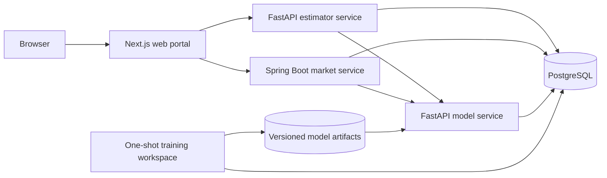

# Housing Intelligence Portal

Public source repository: [`ChenhuaFan/house-price-estimator`](https://github.com/ChenhuaFan/house-price-estimator)

This repository implements both assignments from `requirements/Interview Tasks Fullstack.pdf`:

- a containerised housing-price regression API built with Python 3.12, FastAPI, and Scikit-learn;
- one Next.js portal containing a Python-backed Property Value Estimator and a Java-backed Property Market Analysis application.

The local deployment is designed for a live interview demonstration. Docker Compose starts the complete system, keeps business data in PostgreSQL, and publishes only the portal and Task 1 model API on the host by default.

## What is included

The Property Value Estimator validates all seven model inputs, returns the predicted USD price as a table and chart, stores browser-scoped history, and compares selected estimates side by side.

The Property Market Analysis application shows the supplied housing dataset, contract-driven summary statistics, charts, explicit segment filters, single-field sorting, opaque-cursor pagination, model-backed what-if estimates, and durable asynchronous CSV/PDF exports. Properties, statistics, charts, what-if context, and exports are pinned to one immutable dataset version.

Task 1 exposes single and batch prediction, model metadata and evaluation metrics, health endpoints, OpenAPI 3.1, and Swagger UI.

## Frontend preview

The two screens share the same responsive navigation, semantic design tokens, error patterns, and reduced-motion policy. Initial history and market reads are rendered by React Server Components; later user actions update only their relevant region and preserve the existing dashboard while URL-backed filter, sort, and cursor transitions complete.

### Property Value Estimator


### Property Market Analysis


## Architecture



The service boundaries follow business ownership:

| Component | Responsibility |
| --- | --- |
| `web-portal` | Shared App Router layout, Server Component initial loading, browser interaction, and thin BFF routes |
| `model-service` | Canonical input validation, inference, output rounding, model metadata, and Task 1 Swagger API |
| `estimator-service` | Estimate orchestration, idempotency, anonymous history, deletion, and model integration |
| `market-service` | Version-pinned property queries, bounded statistics, signed cursors, what-if orchestration, and durable asynchronous CSV/PDF jobs |
| `training` | Immutable snapshot export, deterministic split, evaluation, model registration, and activation |
| PostgreSQL | Versioned housing catalog, model registry, and durable estimate history |

The detailed design is in [`docs/architecture.md`](docs/architecture.md). Product behavior, technical rules, database design, and test coverage are documented under [`docs/`](docs/).

## Prerequisites

For the local application runtime:

- Docker Engine or Docker Desktop with Docker Compose v2;
- Git;
- GNU Make or a compatible `make` implementation;
- `curl` for smoke checks.

For the complete local quality gate, also install:

- Node.js 20.9 or later with Corepack;
- Python 3 for the OpenAPI contract checker;
- Playwright browser binaries when running the optional cross-browser suite.

Python 3.12, Java 21, Maven, PostgreSQL, and Flyway run in containers. They do not need to be installed on the host.

## Start from a fresh clone

1. Create the ignored local environment file:

   ```sh
   cp .env.example .env
   ```

2. Replace every example password in `.env`. Keep `PUBLISH_HOST=127.0.0.1` for the ordinary local demonstration.

3. Build the images, migrate and seed PostgreSQL, train and activate the initial model when needed, start every application service, and run smoke checks:

   ```sh
   make bootstrap
   ```

4. Confirm that all long-running containers are healthy:

   ```sh
   docker compose ps
   ```

`make bootstrap` is idempotent with respect to model activation. On a new database it runs the complete training pipeline. If an active model already exists, it reuses that model and only brings the application stack up to date. Ordinary `make up` and service restarts never retrain or replace the model.

The Make targets tag every application image with the current 12-character Git commit and pass the full commit to training metadata. Set `IMAGE_TAG` explicitly only when an intentional alternate release label is required.

After the first bootstrap, use these commands for day-to-day operation:

```sh
make up       # build and start the existing environment
make smoke    # check model readiness, Swagger, and both portal applications
make down     # stop containers; named volumes and data are retained
```

Running `docker compose down --volumes` intentionally deletes the PostgreSQL database, snapshots, training runs, and model artifacts. Use it only when a complete local reset is wanted.

## Local URLs

| Surface | URL |
| --- | --- |
| Portal home | <http://127.0.0.1:3000> |
| Property Value Estimator | <http://127.0.0.1:3000/estimator> |
| Property Market Analysis | <http://127.0.0.1:3000/market> |
| Task 1 Swagger UI | <http://127.0.0.1:8000/docs> |
| Task 1 OpenAPI document | <http://127.0.0.1:8000/openapi.json> |
| Task 1 health | <http://127.0.0.1:8000/health> |
| Task 1 readiness | <http://127.0.0.1:8000/health/ready> |

The estimator service, market service, and PostgreSQL stay on the private Compose network. To inspect estimator Swagger temporarily on the loopback interface, run:

```sh
make up-debug
```

Then open <http://127.0.0.1:8001/docs>. The debug override does not expose the Java service or PostgreSQL.

## Task 1 API example

The prediction body accepts either `property` for one item or `properties` for a batch of 1 to 1,000 items. This single-property request uses every model feature:

```sh
curl --fail-with-body \
  -H 'Content-Type: application/json' \
  -X POST http://127.0.0.1:8000/api/v1/predict \
  --data '{
    "property": {
      "square_footage": 1500,
      "bedrooms": 3,
      "bathrooms": 2.0,
      "year_built": 1995,
      "lot_size": 6000,
      "distance_to_city_center": 5.0,
      "school_rating": 8.0
    }
  }'
```

Use `GET /api/v1/model-info` to inspect the active model version, feature order, coefficients, intercept, dataset lineage, and held-out evaluation metrics. The committed contract is [`contracts/openapi/model-service.openapi.json`](contracts/openapi/model-service.openapi.json).

## Interview demonstration path

The following sequence covers the PDF deliverables without relying on internal ports:

1. Open Task 1 Swagger UI. Run `GET /health`, `GET /api/v1/model-info`, and `POST /api/v1/predict` with one record and then a batch.
2. Use [`requirements/Test Data For Prediction.csv`](requirements/Test%20Data%20For%20Prediction.csv) as the batch demonstration input. This file is never used for training or market actual-price data.
3. Open the estimator, submit a property, inspect the result table and chart, reload the page to show durable history, select two estimates for comparison, and use the View/Delete/Clear actions.
4. Open the market dashboard, apply and reset a segment filter, sort one column, browse with Next/Back cursors, reload or share the query-string URL, run a what-if estimate, and follow a CSV or PDF job from Queued to Download.
5. Return to the unfiltered market view and confirm that all 50 source rows are represented.

## Data and database initialization

Flyway migrations in [`database/migrations/`](database/migrations/) create separate `catalog`, `ml_registry`, and `estimator` schemas with least-privilege runtime roles. Migration `V005` loads the 50 labelled records from `House Price Dataset.csv` as the initial immutable dataset version:

```text
00000000-0000-4000-8000-000000000001
```

Run migrations independently with:

```sh
make db-migrate
```

The demonstration prediction CSV is deliberately not seeded into PostgreSQL. Dataset lineage, canonical hashes, numeric types, and schema ownership are specified in [`docs/data-schema.md`](docs/data-schema.md).

## Model training and activation

To execute a new complete training run and immediately activate the accepted model:

```sh
make train MODEL_VERSION=housing-linear-interview-v2
```

The command exports the selected central dataset version, creates the deterministic 80/20 split, evaluates the model and baseline, checks the acceptance policy, fits the accepted production artifact on all valid rows, registers it, and activates it. Override the dataset version when required:

```sh
make train \
  DATASET_VERSION_ID=00000000-0000-4000-8000-000000000001 \
  MODEL_VERSION=housing-linear-interview-v2
```

Candidate-only publication, explicit activation, stage-by-stage commands, artifact schemas, metrics, and failure reconciliation are documented in [`training/README.md`](training/README.md).

## Tests and release verification

Install the pinned portal dependencies once when running host-side frontend tests:

```sh
cd web-portal
corepack pnpm install --frozen-lockfile
cd ..
```

Run the unit, component, integration, lint, type, coverage, and production-build gates:

```sh
make test
```

Run the complete release gate, including Compose validation, every image build, bootstrap, smoke tests, live OpenAPI contract comparison, accessibility checks, and Chromium E2E journeys:

```sh
make verify
```

The frontend can also be verified independently while backend work is in progress. This command starts contract-faithful in-process mocks for the Estimator and Market v2 APIs, launches Next.js on an isolated port, and runs the Chromium user journeys, accessibility audit, reduced-motion check, and mobile overflow check:

```sh
cd web-portal
corepack pnpm test:e2e:mock
```

The previous live-stack release results, runtime versions, clean-start lineage, browser matrix, and PDF inspection are retained in the [`release acceptance report`](docs/test-report.md). Run the mock-backed frontend gate above for this redesign when the backend stack is not available.

The enforced minimum is 80% line coverage and 70% branch coverage for each tested service. The Portal, Python services, and Java service fail their builds when the configured thresholds are missed.

Useful focused commands are:

```sh
make python-test             # Ruff, mypy, pytest, and Python coverage gates
./scripts/test-market.sh     # disposable-PostgreSQL Java tests and JaCoCo gates
make e2e                     # Chromium against an already running stack
make contracts-validate      # compare live OpenAPI documents with reviewed snapshots
```

For the full Playwright browser matrix:

```sh
cd web-portal
corepack pnpm exec playwright install chromium firefox webkit
corepack pnpm test:e2e:all
```

If an intentional API change is compatible with the current version, start the stack, review the generated differences, and update the snapshots with `make contracts-update`. Breaking changes require a new API version or an explicit migration decision.

## LAN demonstration

The default environment binds host ports to loopback. To demonstrate from another device on a trusted LAN:

```sh
cp .env.lan.example .env.lan
```

Edit `.env.lan` before continuing:

- replace every password;
- set `PORTAL_PUBLIC_ORIGIN` to this machine's actual LAN URL;
- choose the intended `PUBLISH_HOST` instead of accepting a broad interface by accident;
- keep the host firewall enabled.

Then run:

```sh
make up-lan
```

The local build has no login system because the source PDF does not require one. Do not expose it directly to the public internet. Authentication, TLS termination, rate limiting, and internet-facing hardening require a separate deployment decision.

## Troubleshooting

Use these commands first:

```sh
docker compose ps
docker compose logs --tail=200 model-service estimator-service market-service web-portal
make smoke
```

- If the model service is not ready, verify that `make bootstrap` completed and that an active model and its artifact volume exist.
- If a port is already in use, change `WEB_PORT`, `MODEL_PORT`, or `ESTIMATOR_DEBUG_PORT` in the relevant environment file.
- If OpenAPI validation reports a diff, treat it as a contract review. Do not update snapshots until the runtime change is understood.
- If a training run reports `REGISTRY_RECONCILIATION_REQUIRED`, follow the reconciliation command in [`training/README.md`](training/README.md) before starting another stage.

## Repository guide

| Path | Contents |
| --- | --- |
| [`docs/requirements.md`](docs/requirements.md) | Product requirements with PDF/project-decision provenance |
| [`docs/constraints.md`](docs/constraints.md) | Technology, security, quality, accessibility, and deployment rules |
| [`docs/architecture.md`](docs/architecture.md) | Components, flows, failure behavior, and deployment topology |
| [`docs/frontend-design.md`](docs/frontend-design.md) | Task 2 frontend behaviour, RSC/client boundaries, data flow, Motion policy, and black-box acceptance criteria |
| [`docs/data-schema.md`](docs/data-schema.md) | PostgreSQL schemas, model registry, numeric contracts, and lineage |
| [`docs/e2e-test-plan.md`](docs/e2e-test-plan.md) | User and live-system acceptance cases |
| [`docs/integration-test-plan.md`](docs/integration-test-plan.md) | Service tests and requirement traceability matrix |
| [`docs/test-report.md`](docs/test-report.md) | Evidence and outstanding delivery items for the current release candidate |
| [`contracts/openapi/`](contracts/openapi/) | Reviewed OpenAPI 3.1 snapshots for all three backends |
| [`requirements/`](requirements/) | Authoritative PDF and supplied CSV fixtures |
