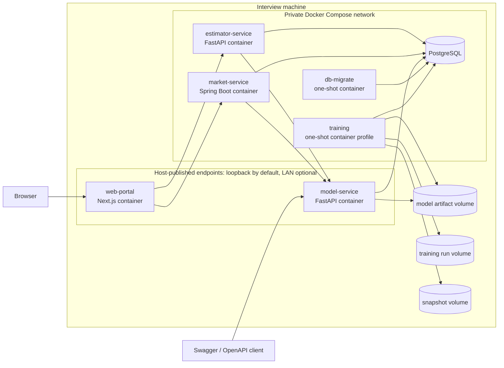
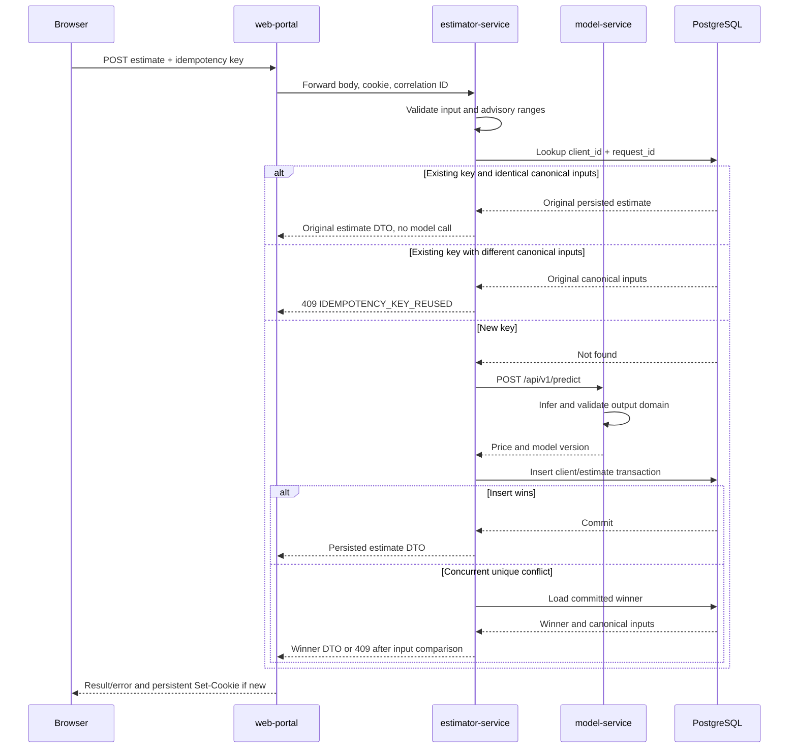

# System Architecture

## 1. Status and Scope

This document is the authoritative runtime and component architecture for the interview project. It translates the product behavior in [`requirements.md`](requirements.md), the engineering rules in [`constraints.md`](constraints.md), and the persistence design in [`data-schema.md`](data-schema.md) into one implementable system shape.

[`Interview Tasks Fullstack.pdf`](../requirements/Interview%20Tasks%20Fullstack.pdf) remains authoritative for the interview task's source requirements. The service boundaries, PostgreSQL usage, filesystem-backed model registry, and local Docker Compose topology in this document are project decisions made to keep the result reproducible and demonstrable. They are not presented as PDF-mandated infrastructure.

The current target is a single-machine interview environment. Cloud hosting, Kubernetes, multi-region operation, public user accounts, and a training dashboard are outside the current scope.

## 2. Architecture Drivers

The architecture prioritizes:

1. faithful coverage of both PDF tasks;
2. a reliable live demonstration with Swagger/OpenAPI and one web portal;
3. reproducible dataset, training, evaluation, and model lineage;
4. coarse service boundaries aligned with the required Python and Java backends;
5. one authoritative copy of business data and one active model version;
6. failure behavior that does not silently retrain, lose history, or serve an unverified model;
7. minimal operational machinery appropriate for a 50-row seed dataset and an interview deployment.

Workloads are classified before technologies are assigned:

| Workload | Execution model | State |
| --- | --- | --- |
| Portal rendering and browser API mediation | Synchronous HTTP | Stateless |
| Single/batch inference | Synchronous HTTP | Verified model held in process memory |
| Estimation and history | Synchronous HTTP plus one local database transaction | PostgreSQL `estimator` schema |
| Market queries, statistics, and charts | Synchronous HTTP | PostgreSQL `catalog`; disposable in-process cache |
| Market CSV/PDF exports | Asynchronous durable jobs plus synchronous status/download HTTP | PostgreSQL `market_ops` job metadata; bounded export storage |
| Dataset export, model training, evaluation, and publication | Explicit one-shot CLI/container workflow | Snapshot/run/artifact files plus PostgreSQL `ml_registry` |
| Schema creation and initial seed | Explicit one-shot migration job | PostgreSQL |

No queue, event bus, workflow engine, distributed cache, or separate report service is required for the current workload.

## 3. System Context and Trust Boundaries



Every long-running component, including Next.js and both FastAPI applications, runs in Docker. Only `web-portal` and the Task 1 `model-service` are host-published by the base Compose file, and both bind to loopback by default. A documented LAN override changes the host bind address without changing the images. The browser does not connect directly to PostgreSQL or the private application services.

## 4. Deployable Units

### 4.1 Long-running application services

| Unit | Runtime | Responsibility | Authoritative state |
| --- | --- | --- | --- |
| `web-portal` | Next.js 15 / Node.js 20 | Server-rendered application shell, client-side business-data loading, browser-facing route handlers, forms, charts, tables, and downloads | None |
| `model-service` | Python 3.12 / FastAPI / Scikit-learn | Task 1 prediction, model information, health, active-model loading, and artifact verification | None; reads `ml_registry` and model artifacts |
| `estimator-service` | Python 3.12 / FastAPI | Estimator validation, model orchestration, anonymous history, deletion, and comparison data | PostgreSQL `estimator` schema |
| `market-service` | Java 21 / Spring Boot 3.4.4 | Versioned market queries, aggregates, chart series, sorting/filtering, what-if calls, Caffeine caching, and CSV/PDF generation | Reads PostgreSQL `catalog`; writes `market_ops.export_jobs` and bounded export files |

CSV and PDF generation belong to `market-service`. They use the same resolved dataset version, normalized filters, sort, aggregate result, chart series, and what-if result as the dashboard. A separate `report-service` would add a deployment boundary without independent data ownership, scaling needs, or lifecycle ownership.

### 4.2 One-shot units and infrastructure

| Unit | Responsibility | Invocation |
| --- | --- | --- |
| `db-migrate` | Create roles/schemas/tables/functions and seed `house-price-v1` | Automatically before application readiness or explicitly through `make db-migrate` |
| `training` | Export a chosen dataset version, split locally, train, evaluate, register, and promote a model | Explicit Compose profile or `make train` / `make publish`; never normal service startup |
| PostgreSQL 17 | Central catalog, ML registry, and anonymous estimate history | Persistent Compose service |

PostgreSQL is infrastructure, not an application microservice. The three application schemas and their least-privilege roles are defined in [`data-schema.md`](data-schema.md).

## 5. Repository Shape

The implementation should use explicit top-level ownership rather than a monorepo task framework:

```text
/
  web-portal/
  model-service/
  estimator-service/
  market-service/
  training/
    scripts/
    data/snapshots/
    runs/
    artifacts/
  database/
    migrations/
  docs/
    openapi/
  compose.yaml
  compose.api-debug.yaml
  .env.lan.example
  Makefile
```

Each deployable unit owns its build manifest, tests, and container definition. `docs/openapi/` holds reviewed OpenAPI 3.1 contracts used by providers, consumers, and contract tests. Generated runtime data remains ignored by Git.

## 6. Component Responsibilities

### 6.1 `web-portal`

The portal is the only browser-facing application surface.

- The App Router exposes `/estimator` and `/market` beneath one shared layout and design system.
- React Server Components render the shared shell, navigation, page titles, and non-business explanatory content.
- Client Components load business data through same-origin BFF routes and own interactive forms, filter controls, comparison selection, tables, and chart interaction.
- Smart feature containers own requests, mutations, URL state, and export orchestration; presentational views receive data and callbacks without importing routing or transport concerns.
- URL query parameters are the source of truth for market filters, sort, page, and selected dataset version so views are refreshable and shareable.
- Browser-facing route handlers act as a small backend-for-frontend: they forward the opaque client cookie, add correlation metadata, normalize downstream errors, and stream CSV/PDF responses.
- The portal never performs SQL, loads model artifacts, or owns business data.

The BFF layer must stay thin. Validation that protects business integrity is repeated in the owning backend rather than trusted only to the browser or portal.

### 6.2 `model-service`

The model service is the Task 1 deliverable and the single inference authority.

- At startup it queries the active `ml_registry.model_versions` record and linked evaluation data.
- It resolves model and metadata paths beneath `MODEL_ARTIFACT_ROOT`, verifies their SHA-256 fingerprints, validates the feature contract, and loads the model into memory.
- `/predict` supports one property or an ordered batch of up to 1,000 properties.
- `/model-info` returns the loaded model version, canonical feature order, coefficients, intercept, dataset lineage, and database-backed metrics.
- The PDF requires a simple `health` operation. The project maps that operation to `GET /health`, which returns a small `200 OK` service-status response whenever the process is live. `/health/live` exposes the same project-defined liveness meaning for container tooling; `/health/ready` returns success only when a verified active model is loaded.
- A non-finite, negative, or unrepresentable model output returns `MODEL_OUTPUT_OUT_OF_DOMAIN`; it is never clamped or persisted.

The service loads one active model per process lifetime. Model activation is an explicit maintenance operation followed by a controlled model-service recreate; normal requests never trigger training or artifact reload.

### 6.3 `estimator-service`

The estimator service owns the Property Value Estimator use case.

- It validates the canonical seven fields.
- It derives history ownership exclusively from the opaque first-party cookie; a body or URL value cannot select another history owner.
- It performs an idempotency lookup before inference. A matching `(client_id, request_id)` and identical canonical inputs returns the original persisted estimate; reuse with different inputs returns `409 IDEMPOTENCY_KEY_REUSED`.
- For a new key, it calls `model-service` before opening the estimate-write transaction.
- A successful model response is stored with the exact returned price and model version in one PostgreSQL transaction.
- `UNIQUE (client_id, request_id)` prevents duplicate rows. If concurrent requests race after the initial lookup, the uniqueness loser loads the committed winner and applies the same input comparison, returning the winner for identical inputs or `409` for different inputs.
- History reads use bounded cursor pagination; deletion is scoped by cookie-derived `client_id`.
- Comparison is a read concern over selected estimate records and requires no separate persisted comparison entity.

Failed validation, model timeouts, model-domain errors, and database rollbacks create no partial history row.

### 6.4 `market-service`

The market service owns the Property Market Analysis use case.

Internally it follows the conventional Spring layered call chain used by the team:

```text
Controller
  -> Service
    -> DAO (@Repository)
      -> MyBatis Mapper (@Mapper)
        -> mapper XML
          -> PostgreSQL
```

Controllers implement the generated OpenAPI interfaces and handle only HTTP concerns. Services own business validation, orchestration, caching decisions, and transaction boundaries. DAO classes are the only database-facing types used by Services. Mapper interfaces and their XML files contain SQL and result mappings. The detailed package layout and layer rules are defined in [`spring-boot-technical-design.md`](spring-boot-technical-design.md).

- Every request resolves one explicit or active immutable dataset version before querying records.
- One normalized filter/sort specification defines the record table, aggregate statistics, chart series, CSV, and PDF.
- SQL performs filtering, ordering, pagination, and aggregate calculations. The application does not load the complete catalog at startup.
- What-if analysis validates the seven inputs and calls `model-service`; it never writes the prediction into `catalog`.
- CSV and PDF rendering run as bounded asynchronous jobs and consume the same immutable query definition used by the dashboard.
- Caffeine caches only reconstructible query results. Cache keys include the dataset content hash, normalized query, sort/page where relevant, and model version for what-if results.

Export creation returns a durable job identifier. The portal polls job status and streams completed content from a separate endpoint. Worker, row, output-size, runtime, and retention limits keep the local implementation bounded.

### 6.5 Training workspace

Training is part of the system but not an always-on service and has no UI.

- It creates a run before export begins.
- It reads one explicit catalog dataset version through `training_runtime`.
- It writes an immutable canonical snapshot and manages split, metrics, run-state, model, and metadata files.
- It performs the deterministic local 80/20 evaluation protocol.
- It records every run and every completed evaluation, including rejected models, through controlled `ml_registry` functions.
- It registers an accepted model as `CANDIDATE`; promotion changes the single active model transactionally.
- It cannot modify `catalog`.

Exact schemas, hashes, state transitions, filesystem protocols, and grants are defined in [`data-schema.md`](data-schema.md).

## 7. API and Routing Topology

All service contracts use `/api/v1` and OpenAPI 3.1. Health endpoints may remain outside the versioned business prefix.

| Surface | Representative operations | Caller |
| --- | --- | --- |
| `model-service` | PDF-required prediction, model-info, and health operations mapped by the project to `POST /api/v1/predict`, `GET /api/v1/model-info`, and `GET /health`, plus project-defined `GET /health/live` and `GET /health/ready` | Swagger client, estimator, market |
| `estimator-service` | `POST /api/v1/estimates`, `GET /api/v1/estimates`, `DELETE /api/v1/estimates/{id}`, `DELETE /api/v1/estimates` | Portal BFF only |
| `market-service` | v2 properties/statistics/what-if operations plus export create/status/content/cancel; temporary v1 compatibility routes | Portal BFF only |
| `web-portal` | `/estimator`, `/market`, browser-facing `/api/estimator/*` and `/api/market/*` route handlers | Browser |

The exact request and response schemas live in the OpenAPI documents, not in this architecture narrative. Breaking changes require a new API version or an explicit migration decision.

## 8. Core Runtime Flows

### 8.1 Single-property estimate



The idempotency lookup is read-only. For a genuinely new key, the estimate-write transaction begins only after inference succeeds, avoiding a distributed transaction across the estimator and model services. A retry after a committed response loss returns the original row even if the active model has since changed.

### 8.2 Market analysis and exports

1. After the server-rendered market shell hydrates, the browser asks the portal BFF for normalized filters, sort, page, and an optional explicit `dataset_version_id`.
2. The market Controller maps the generated contract DTO to a Service request. The Service resolves exactly one immutable dataset version and calls the DAO.
3. The DAO calls a MyBatis Mapper whose XML statement returns the matching page or aggregate rows from PostgreSQL under that version.
4. The Service produces the response model from the same normalized query and returns the resolved version/hash through the Controller.
5. The portal includes that resolved version in subsequent CSV/PDF requests.
6. `ExportService` stores a durable `QUEUED` job through `ExportJobDao`; the portal receives `202 Accepted` and polls the job status endpoint.
7. A bounded worker claims the job, streams rows through the DAO/Mapper XML path, writes the file atomically, and records completion metadata.
8. The portal streams completed content from the download endpoint. The export path never scrapes the browser or uses a different dataset selection rule.
9. A PDF request may include the current what-if result, including its model version and warnings.

### 8.3 Training and model publication

```mermaid
flowchart LR
    Start[start_run] --> Export[Export selected catalog version]
    Export --> Snapshot[Canonical immutable snapshot]
    Snapshot --> Split[Local deterministic 80/20 split]
    Split --> Evaluate[Train and evaluate]
    Evaluate --> Decision{Acceptance policy}
    Decision -->|Fail| Rejected[Persist metrics and REJECTED]
    Decision -->|Pass| Refit[Refit production model on full snapshot]
    Refit --> Files[Atomically publish model and metadata files]
    Files --> Candidate[Register CANDIDATE]
    Candidate --> Preflight[Preflight with production loader]
    Preflight --> Stop[Stop model-service for maintenance]
    Stop --> Promote[Promote ACTIVE transactionally]
    Promote --> Reload[Start model-service with new ACTIVE]
```



Every file reference is content-verified before registration. A rejected evaluation remains queryable but produces no model version. Promotion failure leaves the previous active model and the accepted candidate intact.

## 9. Data Ownership and Consistency

| Owner | May write | Must not write |
| --- | --- | --- |
| Migrations | `catalog`, schema DDL, seed records, grants/functions | Runtime history or trained artifacts |
| Training | Registry operations through controlled functions; snapshot/run/artifact files | `catalog`, estimator history |
| Model service | Nothing | All database schemas and artifact files |
| Estimator service | Scoped `estimator` records | `catalog`, `ml_registry` |
| Market service | `market_ops.export_jobs` and controlled export files | `catalog`, `ml_registry`, and estimator history |
| Portal | Browser cookie and URL/UI state | PostgreSQL and shared artifact volumes |

There is no distributed transaction manager.

- Estimate persistence is local to the estimator schema after a completed model call.
- Market analysis is read-only against one resolved dataset version.
- Model registration and lifecycle transitions are local PostgreSQL transactions after immutable files exist.
- Files may temporarily exist without a registry reference after a rollback, but a registry row may never point to partially written bytes.

## 10. Local Deployment Topology

The root `compose.yaml` defines:

| Compose unit | Lifecycle | Host exposure | Persistent mounts |
| --- | --- | --- | --- |
| `postgres` | Long-running | None | `postgres_data` |
| `db-migrate` | One-shot | None | Migration files read-only |
| `model-service` | Long-running | `127.0.0.1:8000` for Swagger/demo | `model_artifacts` read-only |
| `estimator-service` | Long-running | None | None |
| `market-service` | Long-running | None | Persistent bounded export storage |
| `web-portal` | Long-running | `127.0.0.1:3000` | None |
| `training` | Explicit profile / one-shot | None | Snapshots, runs, and artifacts read/write |

Application services share one private network. PostgreSQL credentials are different per runtime role. Connection pools are process-local and deliberately small for the local environment: HikariCP in Java and a bounded PostgreSQL pool in Python. A separate PgBouncer deployment is unnecessary at the current concurrency.

The artifact volume is the only filesystem shared between a long-running application and training. `model-service` mounts it read-only. Snapshot and run volumes are not exposed to the portal, estimator, or market service.

### 10.1 Container listeners versus host publication

Container listeners and host publishing are separate controls:

- `web-portal` runs the Next.js standalone server on `0.0.0.0:3000` inside its container.
- `model-service` and `estimator-service` run Uvicorn on `0.0.0.0:8000` inside their containers.
- `market-service` listens on `0.0.0.0:8080` inside its container.
- Listening on `0.0.0.0` inside a container does not expose the service to the host or LAN. Exposure exists only when Compose declares a `ports` mapping.
- Private calls always use Compose DNS names such as `http://estimator-service:8000`, `http://market-service:8080`, and `http://model-service:8000`; they never use the host's published port.

The base Compose mapping is parameterized but secure by default:

```yaml
services:
  web-portal:
    ports:
      - "${PUBLISH_HOST:-127.0.0.1}:${WEB_PORT:-3000}:3000"

  model-service:
    ports:
      - "${PUBLISH_HOST:-127.0.0.1}:${MODEL_PORT:-8000}:8000"

  estimator-service:
    expose:
      - "8000"
```

`expose` documents the estimator container port for the private Compose network; it does not publish that port on the host.

### 10.2 Publication modes

| Mode | Invocation | Host binding | Intended use |
| --- | --- | --- | --- |
| Default | `make up` | `127.0.0.1` | Development and an interview conducted on the same machine |
| LAN demo | `make up-lan` with `PUBLISH_HOST` / `.env.lan` | A specific LAN address when known, otherwise `0.0.0.0` | Open the portal and model Swagger from another trusted device on the same network |
| FastAPI debug | Add `compose.api-debug.yaml` explicitly | Optional estimator port, default `8001 -> 8000` | Direct estimator Swagger/contract troubleshooting; not used by the portal |

The LAN override does not rebuild different application images. It changes port bindings and supplies the externally visible portal origin. LAN mode must configure `PORTAL_PUBLIC_ORIGIN`, CORS/CSRF trusted origins, and any generated absolute URLs from the selected host address. It must not publish PostgreSQL or `market-service`.

Because the application has no authentication, LAN and FastAPI-debug modes are explicit opt-ins for a trusted network. The README must instruct the operator to stop those modes after the demonstration and to rely on the host firewall rather than forwarding the ports to the public internet.

## 11. Bootstrap, Startup, and Model Activation

### Clean bootstrap

`make bootstrap` orchestrates:

1. start PostgreSQL and wait for database readiness;
2. apply every migration and the 50-row `house-price-v1` seed;
3. create a training run for that explicit dataset version;
4. export, split, train, evaluate, and register an accepted candidate;
5. promote one model to `ACTIVE`;
6. start/recreate `model-service` and wait for verified-model readiness;
7. start the estimator, market service, and portal;
8. run a small smoke check against model Swagger and both portal applications.

### Normal startup

`make up` starts PostgreSQL, applies idempotent migrations, and starts the application services. It never invokes training. On a database with no active model, `model-service` remains not-ready and dependent prediction paths return a controlled unavailable response.

### Later model publication

`make publish MODEL_VERSION=<version>` preflights the candidate with the same loader used by `model-service`, stops the single model-service instance, promotes the candidate transactionally, and starts the service against the new active record. If promotion fails, it restarts against the unchanged previous active model. This creates an explicit short prediction maintenance window without a period in which the running process serves a different version from the registry's active record. Automatic hot reload and zero-downtime model rollout are not required for the interview system.

## 12. Reliability and Failure Behavior

| Failure | Expected behavior |
| --- | --- |
| PostgreSQL unavailable at application startup | Database-dependent services remain not-ready; no in-memory fallback becomes authoritative |
| PostgreSQL unavailable after model startup | Already loaded prediction and cached model information remain usable; a future restart waits for registry access |
| No active model | Model service remains live but not-ready; estimator and what-if calls return a controlled unavailable response |
| Artifact missing or hash mismatch | Model service refuses readiness and never deserializes the unverified file |
| Model timeout/domain error | Estimator writes no history; market what-if fails without affecting ordinary market analysis |
| Estimator database rollback | Idempotency key may be retried; no partial estimate state remains |
| Market cache loss | Results are recomputed from PostgreSQL; no business state is lost |
| CSV/PDF rendering failure | Request fails with correlation ID; no durable export job or partial response is advertised as successful |
| Training phase failure | Existing run becomes `FAILED`, or its local run-state remains pending for registry reconciliation |
| Candidate promotion failure | Transaction rolls back; old active model and accepted candidate remain unchanged |

Retries are limited to safe reads and explicitly idempotent writes. Service clients use bounded connect and response timeouts. Default budgets should be tighter for inference than for PDF rendering, while remaining configurable through environment variables.

## 13. Caching Strategy

Only `market-service` uses an application cache.

- Backend: bounded Caffeine cache through Spring Cache.
- Default TTL: five minutes.
- Key material: dataset content hash, normalized filters, sort, page/page-size when relevant, and model version for what-if results.
- Cached values: immutable analysis DTOs or aggregate/chart projections.
- Never cached as authority: estimate history, model lifecycle writes, money mutations, or generated export files.

Dataset and model versions are part of keys, so activation logically invalidates prior entries by making them unreachable from requests for the new version. Old entries expire through the five-minute TTL or bounded-size eviction instead of requiring unsafe global mutation. Size limits prevent arbitrary filter combinations from growing memory without bound.

## 14. Security Model

The local interview build has no OAuth, login, user profile, or RBAC feature.

- Anonymous history isolation uses the persistent first-party `hsbc_estimator_client` cookie with a random UUIDv4 value, `HttpOnly`, `SameSite=Lax`, `Path=/`, a one-year `Max-Age` and matching `Expires`, and `Secure` whenever the public origin uses HTTPS.
- The cookie contains only an opaque identifier and is never accepted from a JSON owner field.
- Portal-origin and CSRF controls protect cookie-based mutations.
- Ports bind to loopback by default. The explicit LAN override may publish the portal and model Swagger, and the separate debug override may publish estimator Swagger, only on a trusted network. Internal service calls continue to use the Compose network.
- Each database client uses its own least-privilege role.
- Secrets come from ignored environment files or Compose secrets and never appear in images or logs.
- Request sizes, batch sizes, export sizes, and pagination are bounded.
- Artifact paths are root-relative, containment-checked, hash-verified, and never supplied by browser input.

Authentication and public internet hardening require a separate architecture decision before any shared deployment.

## 15. Observability

Every inbound request accepts or creates an `X-Correlation-ID`. A supplied value must be a valid UUID; it is normalized to lowercase hyphenated form, while a missing value is replaced with a generated UUIDv4. Invalid values return `400 INVALID_CORRELATION_ID` before business processing. The UUID is returned to the caller and propagated across portal, estimator/market, and model calls.

Structured logs include service, operation, correlation ID, status, latency, downstream status, resolved dataset version, and model version where applicable. They exclude secrets, cookies, full input rows, and stack traces in client responses.

The local demonstration exposes or logs:

- request count, latency, and error rate by service/operation;
- model-call latency and model-domain errors;
- active model version and readiness state;
- market cache hit/miss ratio;
- prediction, export, and registry-transition failures.

No external metrics, trace, or log platform is required.

## 16. Verification Boundaries

The architecture is verified at service seams, not only through isolated unit tests.

- OpenAPI provider and consumer contract tests cover portal-to-backend and backend-to-model calls.
- The model-service contract and smoke tests verify that the PDF-required health capability remains available through the project-defined `GET /health` mapping and returns simple liveness independently of the stricter `/health/ready` result.
- PostgreSQL container tests cover migrations, grants, schema constraints, run transitions, history isolation, and cursor ordering.
- Artifact tests cover canonical hashes, path containment, registry/file agreement, and model loading.
- End-to-end tests cover estimate creation/history, market filtering/statistics, what-if analysis, CSV/PDF downloads, and downstream failure states.
- A clean-machine smoke workflow validates `make bootstrap`, Swagger, portal navigation, and both applications.

## 17. Intentional Non-goals and Evolution Triggers

| Not included now | Reconsider when |
| --- | --- |
| Training dashboard | Non-technical operators must launch, compare, approve, or schedule runs |
| OAuth/accounts | History must follow people across devices or the system becomes shared/public |
| Separate report service | Export volume requires independent scaling, security isolation, or ownership by another team |
| Queue/workflow engine | Reports or training become durable background jobs with retries or scheduling |
| Object storage | Services run on multiple hosts or artifacts must survive outside one Compose host |
| PgBouncer/read replicas | Concurrent database connections or read load exceed bounded in-process pools |
| Feature store | Multiple models reuse governed online/offline features |
| Kubernetes/cloud infrastructure | The deployment target changes from the interview machine |
| Public internet exposure | Authentication, TLS termination, rate limiting, and a separate threat model are approved |
| Automatic/hot model rollout | Continuous serving and zero-downtime activation become requirements |

These triggers prevent interview-scope simplicity from being mistaken for a permanent enterprise limit while avoiding premature infrastructure now.

## 18. Accepted Architecture Decisions

| Decision | Rationale |
| --- | --- |
| Four long-running application units | Matches portal, Task 1 model, required Python backend, and required Java backend without entity-level microservices |
| Next.js and both FastAPI applications run as containers | One reproducible runtime model; host binding is selected independently as loopback, LAN, or private-only |
| Market exports remain inside `market-service` | One dataset/query contract and no independent lifecycle justify one boundary |
| One PostgreSQL cluster with three schemas/roles | Central durability with explicit ownership and low local operational cost |
| Training is a one-shot subsystem | Reproducible model production is required; a training UI or daemon is not |
| Model files stay on a shared persistent volume | Simple single-host delivery; PostgreSQL stores lineage, paths, hashes, and metrics rather than binary objects |
| Browser uses the portal BFF | Hides private services, centralizes cookies/correlation/error mapping, and keeps backends independently testable |
| Market exports use durable bounded background jobs | Status, cancellation, restart recovery, and streamed downloads are required without holding an HTTP request open during generation |
| No authentication in local scope | The PDF does not require accounts; an opaque cookie is sufficient for anonymous history isolation |
