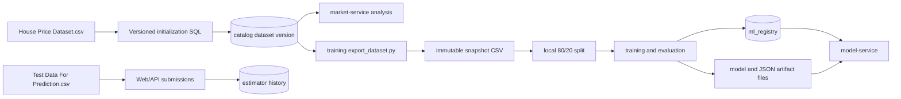
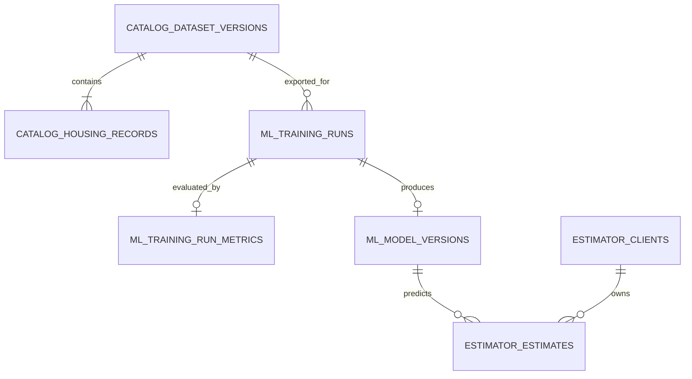

# PostgreSQL Business and Model Registry Schema

## 1. Purpose and Scope

This document is the authoritative persistence design for the project. Runtime components and interactions are defined in [`architecture.md`](architecture.md). This document defines:

- the central, versioned housing dataset used by market analysis and model training;
- the registry records written by the offline training subsystem;
- the anonymous estimate history created through the Property Value Estimator;
- filesystem ownership for exported dataset snapshots and published model artifacts;
- database roles, migration ownership, lifecycle rules, and integrity constraints.

The source PDF does not require a database or training dashboard. PostgreSQL, versioned dataset snapshots, and a lightweight model registry are project architecture decisions that make the required market analysis, model metrics, and live demonstration reproducible. No training dashboard is required in the current scope.

## 2. Authoritative Data Boundaries

| Data | Durable location | Writer | Consumers |
| --- | --- | --- | --- |
| Central housing dataset and versions | PostgreSQL `catalog` schema | Versioned database migrations | `market-service`, training workspace |
| Exported immutable dataset snapshots | `training/data/snapshots/` persistent filesystem | Training workspace | Training and evaluation scripts |
| Local train/evaluation membership | `split-manifest.json` in the training-run directory | Training workspace | Training, evaluation, audit |
| Training-run stage, status, and file lineage | PostgreSQL `ml_registry.training_runs` | Training workspace | Training CLI, model operations |
| Per-run evaluation, baseline metrics, and acceptance result | PostgreSQL `ml_registry.training_run_metrics` | Training workspace | `model-service`, operational inspection |
| Model version, artifact locations, hashes, and lifecycle | PostgreSQL `ml_registry.model_versions` | Controlled registry functions called by training | `model-service`, operational inspection |
| Model binary and version-matched metadata | `training/artifacts/` persistent filesystem | Training workspace | `model-service` |
| Anonymous client identity and estimates | PostgreSQL `estimator` schema | `estimator-service` | `estimator-service` |
| Active market filters and sort | Browser URL/query state | Web portal | Web portal, market API |
| Market aggregate results | Derived on demand; optionally Caffeine | `market-service` | Web portal and exports |
| CSV/PDF export files | Temporary request-scoped storage | `market-service` | Requesting client |
| `Test Data For Prediction.csv` source rows | Repository fixture only | Nobody at runtime | Web/API demonstration tests |

`Test Data For Prediction.csv` is never inserted into `catalog`. When its rows are submitted through the estimator, the resulting predictions are ordinary estimate-history records; the source fixture itself remains outside PostgreSQL.

## 3. Data Flow



Central business data flows one way from `catalog` into training. The training role cannot change `catalog`. Its only database writes are operational metadata in `ml_registry`.

## 4. PostgreSQL Schemas and Access

One PostgreSQL 17 cluster contains three logical schemas.

| Schema | Purpose | Tables |
| --- | --- | --- |
| `catalog` | Immutable, versioned central housing data | `dataset_versions`, `housing_records` |
| `ml_registry` | Training-run, evaluation, and published-model registry | `training_runs`, `training_run_metrics`, `model_versions` |
| `estimator` | Anonymous estimate history | `clients`, `estimates` |

### Runtime Roles

| Role | `catalog` | `ml_registry` | `estimator` |
| --- | --- | --- | --- |
| `db_migration` | DDL and seed writes | DDL | DDL |
| `training_runtime` | `SELECT` | `SELECT` plus controlled run, evaluation, registration, and promotion functions | None |
| `market_runtime` | `SELECT` | None | None |
| `model_runtime` | None | `SELECT` | None |
| `estimator_runtime` | None | No direct reads required | Table/column-scoped history privileges defined below |

The portal does not connect directly to PostgreSQL. Runtime roles have no schema-creation privileges. The `public` schema is not used for application tables.

`V001__create_schemas_and_roles.sql` creates the group roles and revokes unsafe database/`public` defaults. `V002` through `V004` grant schema `USAGE` and object privileges only after their objects exist. `training_runtime` receives no direct mutation privilege on registry tables; run transitions, evaluation recording, candidate registration, and promotion are exposed only through audited `SECURITY DEFINER` functions owned by the migration role. Runtime login credentials are provisioned from local secrets and are not embedded in migrations.

After each schema's objects exist, its migration applies the equivalent of these grants and matching default privileges for future objects:

```sql
REVOKE CREATE ON SCHEMA public FROM PUBLIC;
REVOKE ALL ON SCHEMA catalog, ml_registry, estimator FROM PUBLIC;
REVOKE ALL ON ALL TABLES IN SCHEMA catalog, ml_registry, estimator FROM PUBLIC;

GRANT USAGE ON SCHEMA catalog TO training_runtime, market_runtime;
GRANT SELECT ON catalog.dataset_versions, catalog.housing_records
    TO training_runtime, market_runtime;

GRANT USAGE ON SCHEMA ml_registry TO training_runtime, model_runtime;
GRANT SELECT ON ALL TABLES IN SCHEMA ml_registry
    TO training_runtime;
GRANT SELECT ON ALL TABLES IN SCHEMA ml_registry
    TO model_runtime;

GRANT USAGE ON SCHEMA estimator TO estimator_runtime;
GRANT SELECT, INSERT ON estimator.clients TO estimator_runtime;
GRANT UPDATE (last_seen_at) ON estimator.clients TO estimator_runtime;
GRANT SELECT, INSERT, DELETE ON estimator.estimates TO estimator_runtime;
```

`V003` separately grants `training_runtime` `EXECUTE` on the exact signatures of `start_run`, `advance_run`, `record_evaluation`, `fail_run`, `register_candidate`, and `promote_model`; revokes their default `PUBLIC` execute privilege; fixes their `search_path`; and schema-qualifies every object they access.

## 5. Shared Conventions

- Names use `snake_case`; table names are plural.
- Business and run identifiers use application- or migration-generated UUIDs.
- Timestamps use `timestamptz`, are written in UTC, and default to `now()` where appropriate.
- USD values use `numeric(18,2)` for database business logic.
- Decimal model inputs must already be canonical before they reach PostgreSQL: `bathrooms` is an exact multiple of `0.5`, while `distance_to_city_center` and `school_rating` have at most three effective fractional decimal places. Values requiring scale rounding are rejected by the API; PostgreSQL type coercion must not silently change an input used for inference.
- SHA-256 values are lowercase, 64-character hexadecimal strings.
- Filesystem locations stored in PostgreSQL are relative to their documented snapshot, run, or artifact root and use POSIX separators; they are never machine-specific absolute paths.
- Registered paths must match the `root_relative_path` domain in Section 9. They must also be resolved by the consuming application and rejected unless the canonical resolved path remains beneath its configured root; database string checks alone are not a filesystem security boundary.
- Application queries schema-qualify table names and do not depend on a mutable global `search_path`.
- Schema changes and initial data use versioned SQL migrations; ORM auto-DDL is prohibited.
- Dataset versions, training runs, and model versions are not physically deleted in normal operation. Lifecycle state is changed instead so historical estimates remain traceable.

## 6. Entity Relationships



Train/evaluation membership is intentionally absent from this diagram because it is a versioned training artifact, not central business data.

## 7. `catalog` Schema

### 7.1 `catalog.dataset_versions`

Represents one immutable version of the labelled housing business dataset.

| Column | Type | Null | Rules |
| --- | --- | --- | --- |
| `dataset_version_id` | `uuid` | No | Primary key; stable identifier |
| `version_name` | `varchar(128)` | No | Unique human-readable version such as `house-price-v1` |
| `source_filename` | `text` | No | Original seed filename only, not an arbitrary path |
| `source_sha256` | `char(64)` | No | Hash of the exact source CSV bytes, including any BOM and original line endings |
| `content_sha256` | `char(64)` | No | Hash of the canonical snapshot bytes defined in Section 8 |
| `row_count` | `integer` | No | Number of records; initial version must contain 50 |
| `created_at` | `timestamptz` | No | Defaults to `now()`; immutable |
| `activated_at` | `timestamptz` | Yes | Required for the active version |
| `is_active` | `boolean` | No | At most one active dataset version |

### 7.2 `catalog.housing_records`

Stores the labelled housing rows for a dataset version. `source_id` is the original CSV `id` and is unique only within its version.

| Column | Type | Null | Rules |
| --- | --- | --- | --- |
| `dataset_version_id` | `uuid` | No | Foreign key to `catalog.dataset_versions` |
| `source_id` | `bigint` | No | `>= 1` |
| `square_footage` | `bigint` | No | `>= 1` |
| `bedrooms` | `integer` | No | `>= 0` |
| `bathrooms` | `numeric(12,1)` | No | `>= 0.5`, in increments of `0.5` |
| `year_built` | `integer` | No | `>= 1` |
| `lot_size` | `bigint` | No | `>= 0` |
| `distance_to_city_center` | `numeric(15,3)` | No | Finite and `>= 0` |
| `school_rating` | `numeric(15,3)` | No | Finite; 1-10 remains an advisory domain range |
| `price` | `numeric(18,2)` | No | Finite, `> 0`, USD |

The primary key is `(dataset_version_id, source_id)`.

### 7.3 Catalog DDL

```sql
CREATE SCHEMA IF NOT EXISTS catalog;

CREATE TABLE catalog.dataset_versions (
    dataset_version_id uuid PRIMARY KEY,
    version_name varchar(128) NOT NULL UNIQUE,
    source_filename text NOT NULL CHECK (length(source_filename) > 0),
    source_sha256 char(64) NOT NULL
        CHECK (source_sha256 ~ '^[0-9a-f]{64}$'),
    content_sha256 char(64) NOT NULL
        CHECK (content_sha256 ~ '^[0-9a-f]{64}$'),
    row_count integer NOT NULL CHECK (row_count > 0),
    created_at timestamptz NOT NULL DEFAULT now(),
    activated_at timestamptz,
    is_active boolean NOT NULL DEFAULT false,
    CONSTRAINT catalog_activation_time_required CHECK (
        (is_active AND activated_at IS NOT NULL) OR NOT is_active
    )
);

CREATE UNIQUE INDEX catalog_one_active_dataset_idx
    ON catalog.dataset_versions ((1))
    WHERE is_active;

CREATE TABLE catalog.housing_records (
    dataset_version_id uuid NOT NULL
        REFERENCES catalog.dataset_versions (dataset_version_id) ON DELETE RESTRICT,
    source_id bigint NOT NULL CHECK (source_id >= 1),
    square_footage bigint NOT NULL CHECK (square_footage >= 1),
    bedrooms integer NOT NULL CHECK (bedrooms >= 0),
    bathrooms numeric(12,1) NOT NULL CHECK (
        bathrooms > '-Infinity'::numeric
        AND bathrooms < 'Infinity'::numeric
        AND bathrooms >= 0.5
        AND mod(bathrooms * 2, 1) = 0
    ),
    year_built integer NOT NULL CHECK (year_built >= 1),
    lot_size bigint NOT NULL CHECK (lot_size >= 0),
    distance_to_city_center numeric(15,3) NOT NULL CHECK (
        distance_to_city_center > '-Infinity'::numeric
        AND distance_to_city_center < 'Infinity'::numeric
        AND distance_to_city_center >= 0
    ),
    school_rating numeric(15,3) NOT NULL CHECK (
        school_rating > '-Infinity'::numeric
        AND school_rating < 'Infinity'::numeric
    ),
    price numeric(18,2) NOT NULL CHECK (
        price > '-Infinity'::numeric
        AND price < 'Infinity'::numeric
        AND price > 0
    ),
    PRIMARY KEY (dataset_version_id, source_id)
);

CREATE INDEX housing_records_price_idx
    ON catalog.housing_records (dataset_version_id, price, source_id);
CREATE INDEX housing_records_square_footage_idx
    ON catalog.housing_records (dataset_version_id, square_footage, source_id);
CREATE INDEX housing_records_bedrooms_idx
    ON catalog.housing_records (dataset_version_id, bedrooms, source_id);
CREATE INDEX housing_records_bathrooms_idx
    ON catalog.housing_records (dataset_version_id, bathrooms, source_id);
CREATE INDEX housing_records_year_built_idx
    ON catalog.housing_records (dataset_version_id, year_built, source_id);
CREATE INDEX housing_records_lot_size_idx
    ON catalog.housing_records (dataset_version_id, lot_size, source_id);
CREATE INDEX housing_records_distance_idx
    ON catalog.housing_records (
        dataset_version_id,
        distance_to_city_center,
        source_id
    );
CREATE INDEX housing_records_school_rating_idx
    ON catalog.housing_records (dataset_version_id, school_rating, source_id);
```

### 7.4 Initialization and Dataset Lifecycle

- Versioned SQL initializes `house-price-v1` and its 50 labelled rows from `House Price Dataset.csv`.
- The migration uses a stable `dataset_version_id`, records both source and normalized-content hashes, validates the row count, and activates the version in one transaction.
- `Test Data For Prediction.csv` is not referenced by any seed migration.
- Only `db_migration` may insert, update, activate, or retire catalog versions.
- Future data versions use new migrations or a separately reviewed import workflow. Existing versions and records remain immutable.
- Market requests resolve the active version once and use it consistently for tables, statistics, charts, and exports.
- Market sorting always adds `source_id` as the final tie-breaker.

## 8. Training Snapshot and Local Split

The training workspace consumes central data without changing it.

### 8.1 Snapshot Export

`training/scripts/export_dataset.py` must:

1. create the durable `training_runs` row and local `run-state.json` before database export begins;
2. connect with `training_runtime`;
3. require an explicit `dataset_version_id` rather than silently using whatever is active;
4. use a read-only, repeatable-read transaction for the catalog query;
5. select canonical fields in stable `source_id` order;
6. verify the row count and central `content_sha256`;
7. atomically write `dataset.csv` and `snapshot-metadata.json` beneath a persistent snapshot root;
8. calculate the exact exported file fingerprints and update the run record;
9. never write to `catalog`.

The canonical `dataset.csv` byte representation is normative:

- UTF-8 without a BOM;
- LF line endings and exactly one terminal LF;
- this exact header and column order: `source_id,square_footage,bedrooms,bathrooms,year_built,lot_size,distance_to_city_center,school_rating,price`;
- rows sorted by ascending `source_id`;
- integers written as base-10 digits without a leading `+` or unnecessary leading zeroes;
- `bathrooms` written with one fractional digit, `distance_to_city_center` and `school_rating` with three, and `price` with two;
- RFC 4180 escaping if a future schema adds a non-numeric field.

`catalog.dataset_versions.content_sha256` is the SHA-256 of these canonical bytes. The initial source-file SHA-256, including its supplied UTF-8 BOM and CRLF endings, is `0e36c6224e1f6fb97c308c9dbe1d6da22d78d78055181067f8ac4c7155a4a726`; its canonical 50-row snapshot SHA-256 is `941c3d0fecd13fb2494bd97ffed44427047da708f17de871ab09a8eae41e6548`.

Canonical layout:

```text
training/data/snapshots/<dataset-version-id>/<snapshot-sha256>/
  dataset.csv
  snapshot-metadata.json
```

`snapshot_path` always names the `dataset.csv` file, not its directory. `snapshot-metadata.json` uses schema version `1` and requires: `schema_version`, `dataset_version_id`, `version_name`, `source_filename`, `source_sha256`, `content_sha256`, `snapshot_sha256`, `row_count`, `column_order`, `exported_at`, `export_tool_version`, and `git_commit_sha`. Re-running an export for the same version must either verify and reuse byte-identical files or fail; it must never overwrite different bytes at an existing content-addressed path.

### 8.2 Local Split

The training script performs `train_test_split` locally with:

- `test_size=0.20`;
- `random_state=42`;
- `shuffle=True`.

The exact TRAIN and EVALUATION `source_id` membership is written to `split-manifest.json` in the training-run directory. It is never written to `catalog` or used by the market service.

`split-manifest.json` uses schema version `1` and requires: `schema_version`, `training_run_id`, `dataset_version_id`, `snapshot_sha256`, `algorithm`, `library_version`, `shuffle`, `random_seed`, `train_ratio`, sorted `training_source_ids`, sorted `evaluation_source_ids`, and their row counts. The two ID sets must be disjoint and their union must equal every `source_id` in the snapshot.

After evaluation passes, the published production model is fitted on all valid rows in the immutable snapshot. Evaluation metrics continue to describe the held-out evaluation run, not the final all-row fit.

## 9. `ml_registry` Schema

The registry supplies durable run progress, evaluation results, and model lineage without requiring a training dashboard. Artifact files remain on the filesystem; PostgreSQL stores their logical locations, fingerprints, metrics, and lifecycle state.

### 9.1 `ml_registry.training_runs`

One row is created before an attempted export begins. File and row-count columns remain nullable only while the corresponding stage has not completed or when the run fails earlier.

| Column group | Null | Rules |
| --- | --- | --- |
| `training_run_id`, `dataset_version_id`, `git_commit_sha` | No | Stable run identity, selected catalog version, and source revision |
| `run_stage` | No | `EXPORTING`, `SPLITTING`, `TRAINING`, `EVALUATING`, `REGISTERING`, or `COMPLETE` |
| `run_status` | No | `RUNNING`, `SUCCEEDED`, `REJECTED`, or `FAILED` |
| Snapshot CSV and metadata paths/hashes | Yes while incomplete | All four values become non-null together after export |
| Split manifest path/hash and row counts | Yes while incomplete | All values become non-null together after splitting |
| `split_seed`, `train_ratio` | No | Exactly `42` and `0.8000` for the current protocol |
| `state_revision` | No | Monotonic revision incremented by every registry transition |
| `started_at`, `completed_at`, `error_summary` | Conditional | Terminal runs have completion time; only failures have an error summary |

`REJECTED` means training and evaluation completed normally but failed the acceptance policy. It is not an infrastructure failure.

### 9.2 `ml_registry.training_run_metrics`

One row is inserted for every completed evaluation, including rejected models. It stores the versioned `metrics.json` location and hash, model metrics, baseline metrics, acceptance-policy version, result, and evaluation time. A failed run that never completed evaluation has no metrics row.

`metrics.json` uses schema version `1` and requires: `schema_version`, `training_run_id`, `dataset_version_id`, `snapshot_sha256`, `split_manifest_sha256`, row counts, model and baseline MAE/RMSE/MAPE, model R², acceptance-policy version, every threshold result, overall acceptance result, and `evaluated_at`. MAPE values are percentage points, not unit fractions: an error of 3.788% is encoded as `3.788000000000`. Every metric is encoded as the same fixed 12-fractional-digit decimal string stored in PostgreSQL. PostgreSQL stores the queryable scalar values; the JSON file preserves the complete versioned evaluation report.

### 9.3 `ml_registry.model_versions`

One row is created only through the controlled registration function for an accepted, successful run whose model and metadata files have been fully written and fingerprinted. Evaluation metrics are joined through `training_run_id`; they are not duplicated in this table.

| Column | Type | Null | Rules |
| --- | --- | --- | --- |
| `model_version` | `varchar(128)` | No | Primary key and external model identifier |
| `training_run_id` | `uuid` | No | Unique foreign key to the successful run and its metrics |
| `model_type` | `varchar(128)` | No | Current value is `LinearRegression` |
| `artifact_path`, `artifact_sha256` | Path/hash | No | Versioned `model.joblib` reference |
| `metadata_path`, `metadata_sha256` | Path/hash | No | Version-matched metadata reference |
| `lifecycle_status` | `varchar(16)` | No | `CANDIDATE`, `ACTIVE`, or `RETIRED` |
| `created_at` | `timestamptz` | No | Defaults to `now()` |
| `activated_at`, `retired_at` | `timestamptz` | Conditional | Enforce the allowed lifecycle sequence |

### 9.4 Registry DDL

```sql
CREATE SCHEMA IF NOT EXISTS ml_registry;

CREATE DOMAIN ml_registry.root_relative_path AS text
CHECK (
    VALUE ~ '^[A-Za-z0-9][A-Za-z0-9._/-]*$'
    AND VALUE !~ '(^|/)\.\.(/|$)'
    AND VALUE !~ '(^|/)\.(/|$)'
    AND VALUE !~ '//'
);

CREATE TABLE ml_registry.training_runs (
    training_run_id uuid PRIMARY KEY,
    dataset_version_id uuid NOT NULL
        REFERENCES catalog.dataset_versions (dataset_version_id) ON DELETE RESTRICT,
    git_commit_sha varchar(64) NOT NULL CHECK (
        git_commit_sha ~ '^[0-9a-f]{7,64}$'
    ),
    run_stage varchar(16) NOT NULL CHECK (run_stage IN (
        'EXPORTING', 'SPLITTING', 'TRAINING',
        'EVALUATING', 'REGISTERING', 'COMPLETE'
    )),
    run_status varchar(16) NOT NULL CHECK (
        run_status IN ('RUNNING', 'SUCCEEDED', 'REJECTED', 'FAILED')
    ),
    snapshot_path ml_registry.root_relative_path,
    snapshot_sha256 char(64) CHECK (
        snapshot_sha256 IS NULL OR snapshot_sha256 ~ '^[0-9a-f]{64}$'
    ),
    snapshot_metadata_path ml_registry.root_relative_path,
    snapshot_metadata_sha256 char(64) CHECK (
        snapshot_metadata_sha256 IS NULL
        OR snapshot_metadata_sha256 ~ '^[0-9a-f]{64}$'
    ),
    split_manifest_path ml_registry.root_relative_path,
    split_manifest_sha256 char(64) CHECK (
        split_manifest_sha256 IS NULL
        OR split_manifest_sha256 ~ '^[0-9a-f]{64}$'
    ),
    split_seed integer NOT NULL DEFAULT 42 CHECK (split_seed = 42),
    train_ratio numeric(5,4) NOT NULL DEFAULT 0.8000
        CHECK (train_ratio = 0.8000),
    state_revision bigint NOT NULL DEFAULT 0 CHECK (state_revision >= 0),
    total_rows integer CHECK (total_rows IS NULL OR total_rows > 1),
    training_rows integer CHECK (training_rows IS NULL OR training_rows > 0),
    evaluation_rows integer CHECK (evaluation_rows IS NULL OR evaluation_rows > 0),
    started_at timestamptz NOT NULL DEFAULT now(),
    completed_at timestamptz,
    error_summary text,
    CONSTRAINT training_run_snapshot_group CHECK (
        (snapshot_path IS NULL AND snapshot_sha256 IS NULL
            AND snapshot_metadata_path IS NULL
            AND snapshot_metadata_sha256 IS NULL)
        OR
        (snapshot_path IS NOT NULL AND snapshot_sha256 IS NOT NULL
            AND snapshot_metadata_path IS NOT NULL
            AND snapshot_metadata_sha256 IS NOT NULL)
    ),
    CONSTRAINT training_run_split_group CHECK (
        (split_manifest_path IS NULL AND split_manifest_sha256 IS NULL
            AND total_rows IS NULL AND training_rows IS NULL
            AND evaluation_rows IS NULL)
        OR
        (split_manifest_path IS NOT NULL AND split_manifest_sha256 IS NOT NULL
            AND total_rows IS NOT NULL AND training_rows IS NOT NULL
            AND evaluation_rows IS NOT NULL)
    ),
    CONSTRAINT training_run_row_count_matches CHECK (
        total_rows IS NULL OR total_rows = training_rows + evaluation_rows
    ),
    CONSTRAINT training_run_terminal_state CHECK (
        (run_status = 'RUNNING' AND run_stage <> 'COMPLETE'
            AND completed_at IS NULL AND error_summary IS NULL)
        OR
        (run_status IN ('SUCCEEDED', 'REJECTED') AND run_stage = 'COMPLETE'
            AND completed_at IS NOT NULL AND error_summary IS NULL
            AND snapshot_path IS NOT NULL AND split_manifest_path IS NOT NULL)
        OR
        (run_status = 'FAILED' AND run_stage <> 'COMPLETE'
            AND completed_at IS NOT NULL
            AND length(trim(coalesce(error_summary, ''))) > 0)
    )
);

CREATE INDEX training_runs_dataset_time_idx
    ON ml_registry.training_runs (dataset_version_id, started_at DESC);

CREATE TABLE ml_registry.training_run_metrics (
    training_run_id uuid PRIMARY KEY
        REFERENCES ml_registry.training_runs (training_run_id) ON DELETE RESTRICT,
    metrics_path ml_registry.root_relative_path NOT NULL,
    metrics_sha256 char(64) NOT NULL
        CHECK (metrics_sha256 ~ '^[0-9a-f]{64}$'),
    mae numeric(30,12) NOT NULL CHECK (
        mae > '-Infinity'::numeric AND mae < 'Infinity'::numeric AND mae >= 0
    ),
    rmse numeric(30,12) NOT NULL CHECK (
        rmse > '-Infinity'::numeric AND rmse < 'Infinity'::numeric AND rmse >= 0
    ),
    r2 numeric(30,12) NOT NULL CHECK (
        r2 > '-Infinity'::numeric AND r2 < 'Infinity'::numeric AND r2 <= 1
    ),
    mape numeric(30,12) NOT NULL CHECK (
        mape > '-Infinity'::numeric AND mape < 'Infinity'::numeric AND mape >= 0
    ),
    baseline_mae numeric(30,12) NOT NULL CHECK (
        baseline_mae > '-Infinity'::numeric
        AND baseline_mae < 'Infinity'::numeric
        AND baseline_mae >= 0
    ),
    baseline_rmse numeric(30,12) NOT NULL CHECK (
        baseline_rmse > '-Infinity'::numeric
        AND baseline_rmse < 'Infinity'::numeric
        AND baseline_rmse >= 0
    ),
    baseline_mape numeric(30,12) NOT NULL CHECK (
        baseline_mape > '-Infinity'::numeric
        AND baseline_mape < 'Infinity'::numeric
        AND baseline_mape >= 0
    ),
    acceptance_policy_version varchar(64) NOT NULL
        CHECK (acceptance_policy_version = 'housing-linear-v1'),
    acceptance_passed boolean NOT NULL,
    evaluated_at timestamptz NOT NULL DEFAULT now(),
    CONSTRAINT metrics_acceptance_matches_policy CHECK (
        acceptance_passed = (
            mae <= 15000
            AND rmse <= 20000
            AND r2 >= 0.9000
            AND mape <= 7.5000
            AND mae < baseline_mae
            AND rmse < baseline_rmse
            AND mape < baseline_mape
        )
    )
);

CREATE TABLE ml_registry.model_versions (
    model_version varchar(128) PRIMARY KEY CHECK (
        model_version ~ '^[A-Za-z0-9][A-Za-z0-9._-]{0,127}$'
    ),
    training_run_id uuid NOT NULL UNIQUE
        REFERENCES ml_registry.training_runs (training_run_id) ON DELETE RESTRICT,
    model_type varchar(128) NOT NULL CHECK (length(model_type) > 0),
    artifact_path ml_registry.root_relative_path NOT NULL,
    artifact_sha256 char(64) NOT NULL
        CHECK (artifact_sha256 ~ '^[0-9a-f]{64}$'),
    metadata_path ml_registry.root_relative_path NOT NULL,
    metadata_sha256 char(64) NOT NULL
        CHECK (metadata_sha256 ~ '^[0-9a-f]{64}$'),
    lifecycle_status varchar(16) NOT NULL CHECK (
        lifecycle_status IN ('CANDIDATE', 'ACTIVE', 'RETIRED')
    ),
    created_at timestamptz NOT NULL DEFAULT now(),
    activated_at timestamptz,
    retired_at timestamptz,
    CONSTRAINT model_lifecycle_timestamps CHECK (
        (lifecycle_status = 'CANDIDATE'
            AND activated_at IS NULL AND retired_at IS NULL)
        OR
        (lifecycle_status = 'ACTIVE'
            AND activated_at IS NOT NULL AND retired_at IS NULL)
        OR
        (lifecycle_status = 'RETIRED'
            AND activated_at IS NOT NULL AND retired_at IS NOT NULL
            AND retired_at >= activated_at)
    )
);

CREATE UNIQUE INDEX model_versions_one_active_idx
    ON ml_registry.model_versions ((1))
    WHERE lifecycle_status = 'ACTIVE';
```

Cross-table rules that cannot be expressed as a row `CHECK` are enforced by the registry functions defined in `V003`, without granting `training_runtime` direct table writes:

- `start_run`, `advance_run`, and `fail_run` enforce allowed stage transitions and terminal-state immutability, incrementing `state_revision` on every committed transition;
- `record_evaluation` accepts only canonical 12-fractional-digit decimal strings, calculates the current acceptance result from those exact values, inserts the immutable metrics row, and either advances an accepted run to `REGISTERING` or completes it as `REJECTED`;
- registration requires a `RUNNING` run at `REGISTERING`, a metrics row whose values satisfy the versioned policy, and file references verified by the training process immediately before the call; it inserts the `CANDIDATE` and completes the run as `SUCCEEDED` in one transaction;
- a completed evaluation with `acceptance_passed = false` inserts its metrics and completes the run as `REJECTED`, with no model-version row;
- promotion takes a transaction-scoped lock, accepts only a `CANDIDATE`, retires the current `ACTIVE` model, activates the candidate, and sets both lifecycle timestamps atomically;
- the allowed lifecycle is only `CANDIDATE -> ACTIVE -> RETIRED`; model rows are never physically deleted in normal operation.

### 9.5 File and Transaction Protocol

- Each phase updates `run_stage`. Any failure updates the existing run to `FAILED` with a sanitized summary. If the registry is unavailable, `run-state.json` remains on persistent storage as `REGISTRY_RECONCILIATION_REQUIRED`; later commands must reconcile it before registration or promotion.
- `run-state.json` uses schema version `1` and requires: `schema_version`, `training_run_id`, `dataset_version_id`, `git_commit_sha`, current `run_stage` and `run_status`, `state_revision`, `last_synced_registry_revision`, `pending_registry_operation`, known snapshot/split/metrics/model paths and hashes, sanitized failure data, `created_at`, and `updated_at`. `pending_registry_operation` is one of `NONE`, `START_RUN`, `ADVANCE_RUN`, `RECORD_EVALUATION`, `FAIL_RUN`, `REGISTER_CANDIDATE`, or `PROMOTE_MODEL`.
- Every `run-state.json` update is written to a unique sibling temporary file, flushed and synced, and atomically renamed. Automatic restart reconciliation is intentionally limited to `FAIL_RUN`: the command creates the missing registry run when necessary, records the saved failure while the run is still `RUNNING`, accepts an already `FAILED` row, synchronizes the manifest, and then stops the failed run from continuing. Other pending-operation values preserve crash evidence for operator review; they are not advertised as a general transaction-replay mechanism. A terminal, fully synchronized manifest is retained with the run artifacts rather than deleted.
- Snapshot, split, metrics, model, metadata, and run-state files are written through a unique sibling temporary path, closed and synced, hashed where applicable, and atomically renamed before the referencing database transaction commits.
- A database rollback may leave an unregistered content-addressed directory. Cleanup may remove only directories that have no registry reference and are older than the configured reconciliation window. Registered files are immutable and never overwritten.
- `model_version` uniqueness and atomic directory creation prevent concurrent writers from publishing different bytes under the same version. Hash verification detects accidental replacement.
- The model service joins the active model to its training run and database metrics, resolves the model and metadata paths beneath `MODEL_ARTIFACT_ROOT`, verifies both fingerprints, and only then loads the model. Missing, escaping, or mismatched files keep readiness false.
- A failed promotion transaction returns a non-zero publication result but does not change the successful training run or accepted `CANDIDATE`; it leaves the previous active model unchanged.
- Model and run rows are retained because historical estimates reference model versions and operational review requires rejected and failed run evidence.

## 10. `estimator` Schema

### 10.1 `estimator.clients`

Stores the anonymous UUID from the persistent first-party `hsbc_estimator_client` cookie. The portal sets the cookie with `HttpOnly`, `SameSite=Lax`, `Path=/`, `Max-Age=31536000`, a matching `Expires` value, and `Secure` whenever HTTPS is used. It is not a user account and contains no personal profile data. Clearing the cookie makes the retained rows unreachable from that browser but does not delete them.

| Column | Type | Null | Rules |
| --- | --- | --- | --- |
| `client_id` | `uuid` | No | Primary key; cryptographically random UUIDv4 |
| `created_at` | `timestamptz` | No | Defaults to `now()`; immutable |
| `last_seen_at` | `timestamptz` | No | Defaults to `now()`; not before creation |

### 10.2 `estimator.estimates`

Stores one successful estimator result. Failed validation and failed predictions create no row.

| Column | Type | Null | Rules |
| --- | --- | --- | --- |
| `estimate_id` | `uuid` | No | Primary key |
| `client_id` | `uuid` | No | Foreign key to the owning anonymous client |
| `request_id` | `uuid` | No | Portal-generated UUIDv4 idempotency key reused for retries |
| `created_at` | `timestamptz` | No | Defaults to `now()` |
| Seven canonical model inputs | Canonical numeric types | No | Same hard rules as `catalog.housing_records` |
| `predicted_price` | `numeric(18,2)` | No | `>= 0`, USD |
| `currency_code` | `char(3)` | No | Must be `USD` |
| `model_version` | `varchar(128)` | No | Foreign key to `ml_registry.model_versions` |
| `correlation_id` | `uuid` | No | Validated request correlation UUID linking history to service logs |

`UNIQUE (client_id, request_id)` is the storage guard for the estimator's single-property idempotency protocol; the constraint alone does not define the API behavior. Before inference, an existing key with the same seven canonical input values returns the original immutable estimate, including its original price, model version, and creation time. Reusing the key with different canonical inputs returns `409 IDEMPOTENCY_KEY_REUSED`. When concurrent new requests both pass the initial lookup, the unique-conflict loser loads the committed winner and applies the same comparison. Task 1 batch-prediction calls do not create estimator history. If a future estimator batch-upload feature persists multiple items from one request, it must add a request-item index to the uniqueness key.

### 10.3 Estimator DDL

```sql
CREATE SCHEMA IF NOT EXISTS estimator;

CREATE TABLE estimator.clients (
    client_id uuid PRIMARY KEY,
    created_at timestamptz NOT NULL DEFAULT now(),
    last_seen_at timestamptz NOT NULL DEFAULT now(),
    CONSTRAINT clients_last_seen_after_creation
        CHECK (last_seen_at >= created_at)
);

CREATE TABLE estimator.estimates (
    estimate_id uuid PRIMARY KEY,
    client_id uuid NOT NULL
        REFERENCES estimator.clients (client_id) ON DELETE CASCADE,
    request_id uuid NOT NULL,
    created_at timestamptz NOT NULL DEFAULT now(),
    square_footage bigint NOT NULL CHECK (square_footage >= 1),
    bedrooms integer NOT NULL CHECK (bedrooms >= 0),
    bathrooms numeric(12,1) NOT NULL CHECK (
        bathrooms > '-Infinity'::numeric
        AND bathrooms < 'Infinity'::numeric
        AND bathrooms >= 0.5
        AND mod(bathrooms * 2, 1) = 0
    ),
    year_built integer NOT NULL CHECK (year_built >= 1),
    lot_size bigint NOT NULL CHECK (lot_size >= 0),
    distance_to_city_center numeric(15,3) NOT NULL CHECK (
        distance_to_city_center > '-Infinity'::numeric
        AND distance_to_city_center < 'Infinity'::numeric
        AND distance_to_city_center >= 0
    ),
    school_rating numeric(15,3) NOT NULL CHECK (
        school_rating > '-Infinity'::numeric
        AND school_rating < 'Infinity'::numeric
    ),
    predicted_price numeric(18,2) NOT NULL CHECK (
        predicted_price > '-Infinity'::numeric
        AND predicted_price < 'Infinity'::numeric
        AND predicted_price >= 0
    ),
    currency_code char(3) NOT NULL DEFAULT 'USD'
        CHECK (currency_code = 'USD'),
    model_version varchar(128) NOT NULL
        REFERENCES ml_registry.model_versions (model_version) ON DELETE RESTRICT,
    correlation_id uuid NOT NULL,
    CONSTRAINT estimates_client_request_unique UNIQUE (client_id, request_id)
);

CREATE INDEX estimates_history_cursor_idx
    ON estimator.estimates (client_id, created_at DESC, estimate_id DESC);
```

### 10.4 History Lifecycle

- Each successful estimate is inserted transactionally with its anonymous client association.
- Idempotent retries return the original estimate and never re-infer after an existing key is found. Concurrent uniqueness conflicts resolve to the committed winner for identical inputs or `409 IDEMPOTENCY_KEY_REUSED` for different inputs.
- `MODEL_OUTPUT_OUT_OF_DOMAIN` and all other failed predictions create no estimate row.
- History is ordered by `(created_at DESC, estimate_id DESC)` and cursor queries also filter by cookie-derived `client_id`.
- Deleting one estimate uses both `client_id` and `estimate_id`.
- Clearing history deletes all estimates for the client but retains the anonymous client row.
- Estimates are immutable until deletion.
- Rows submitted from `Test Data For Prediction.csv` through the Web/API have no special marker; they are ordinary user-input history records associated with the model version that produced them.

## 11. Artifact Layout

Canonical training-run and model-artifact layout:

```text
training/runs/<training-run-id>/
  run-state.json
  split-manifest.json
  metrics.json

training/artifacts/<model-version>/
  model.joblib
  model-metadata.json
```

The run and artifact roots are persistent local volumes writable by the training job. `model-service` receives read-only access only to the artifact root. PostgreSQL stores paths relative to their documented root. The snapshot root is separately persistent and writable only by the training subsystem.

`model-metadata.json` uses schema version `1` and requires: `schema_version`, `model_version`, `training_run_id`, `dataset_version_id`, source/content/snapshot hashes, `model_type`, target, canonical feature order, coefficients, intercept, dependency versions, Git commit, training time, and the hashes of `split-manifest.json` and `metrics.json`.

No generated snapshot or artifact is required to be committed to Git. Source code, migrations, schemas, and documentation are committed.

## 12. Centralized SQL Migrations

All PostgreSQL schemas and seed data use one ordered SQL migration set, applied by a one-shot migration container before application readiness.

```text
database/migrations/
  V001__create_schemas_and_roles.sql
  V002__create_catalog_tables.sql
  V003__create_ml_registry_tables.sql
  V004__create_estimator_tables.sql
  V005__seed_house_price_dataset_v1.sql
  V006__drop_estimate_warnings.sql
```

`V006` removes the obsolete estimator warning table introduced by the historical `V004` migration. Applied migrations remain immutable; a clean database reaches the same final two-table `estimator` schema after the complete migration chain.

`V005` must:

- insert the stable `house-price-v1` version record;
- insert exactly the 50 rows from `House Price Dataset.csv`;
- verify the expected count, source SHA-256, and canonical content SHA-256 documented in Section 8;
- activate the version in the same transaction;
- contain no row from `Test Data For Prediction.csv`.

Migrations must be reproducible against an empty database and verified through checksums. Application services never create or alter tables at startup.

For a clean environment, the explicit bootstrap order is: apply migrations, export the selected dataset version, train and evaluate, publish one active model, then start or mark the application services ready. A root `make bootstrap` command may orchestrate this sequence. Normal service startup must not invoke training, and `model-service` readiness must remain false until it can verify and load an active registered artifact.

## 13. Required Integration Tests

- A clean database applies every migration and contains one active `house-price-v1` version with the documented filename, source hash, canonical content hash, and exactly 50 records.
- The final `estimator` schema contains only `clients` and `estimates`; the obsolete warning table is absent after `V006`.
- Initialization contains no dataset version, source fingerprint, or migration derived from `Test Data For Prediction.csv`.
- Runtime grants prevent training and market roles from changing catalog data.
- Snapshot export for a fixed dataset version is stable in order, row count, and hash.
- Local split membership is exhaustive, disjoint, saved to the training-run directory, and contains 40 training and 10 evaluation rows for the initial 50-row snapshot.
- A failed training run is durable in `ml_registry` and cannot create or activate a model version.
- An export-stage failure can be recorded without requiring snapshot or split fields, and its local run manifest is reconcilable after a registry outage.
- A rejected evaluation has a durable metrics row and no model-version row.
- A published model's registered file paths and SHA-256 fingerprints match the actual files.
- The training role cannot directly mutate registry tables; only the controlled functions can transition runs, record evaluations, register candidates, or promote models.
- Candidate registration rejects a running/failed/rejected run, missing metrics, a failed acceptance result, or an invalid root-relative path.
- Concurrent promotion cannot produce two active model versions.
- `model-service` refuses to start ready when the active artifact is missing or its hash differs.
- Market tables, aggregates, charts, and exports all use one resolved catalog version per request.
- Submitting the demonstration fixture through the estimator creates ordinary history rows without changing `catalog`.
- Two client cookies cannot read or delete each other's estimates.
- Money round-trips through Python, Java, PostgreSQL, JSON, CSV, and PDF without losing the fixed two-decimal value.
- Prediction endpoints reject decimal model inputs that would require PostgreSQL scale rounding, and the exact accepted values used for inference round-trip unchanged through estimate history.
- Stored model and baseline MAPE values use percentage points consistently in `metrics.json`, PostgreSQL, acceptance checks, `model-info`, and user-visible output.
- Retrying an estimator request with the same client, `request_id`, and canonical inputs returns the original estimate without a model call, including after model activation; different inputs with the same key return `409`, and concurrent identical submissions create exactly one row.
- A valid inbound `X-Correlation-ID` UUID round-trips through headers, logs, downstream calls, and estimate persistence; an invalid value returns `400 INVALID_CORRELATION_ID` and creates no history row.
