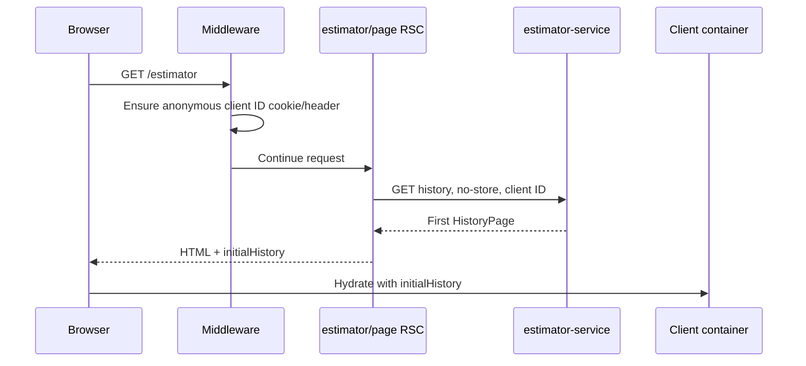
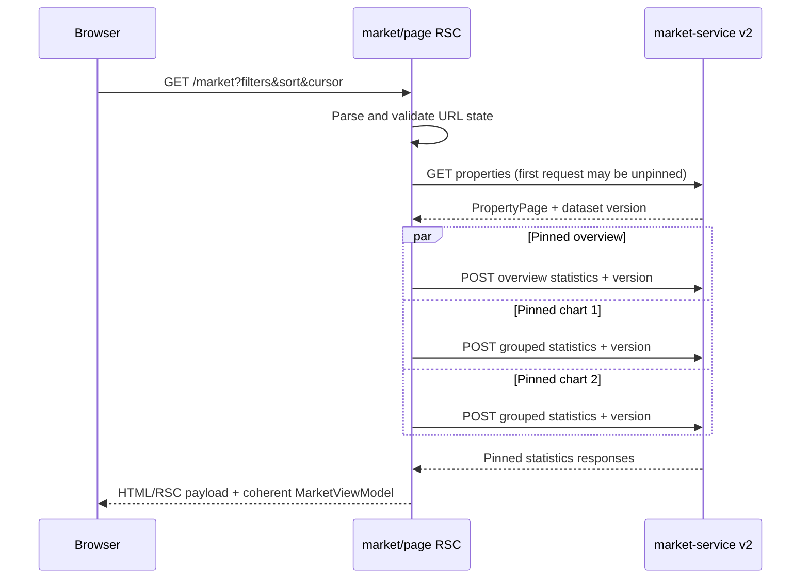

# Frontend technical design

## 1. Status and scope

| Item | Value |
| --- | --- |
| Status | Proposed target design |
| Date | 2026-10-19 |
| Project | `web-portal` |
| Product scope | Multi-Application Next.js Portal |
| Applications | Property Value Estimator and Property Market Analysis |
| Market API baseline | `docs/openapi/market-service-v2.yaml`, OpenAPI 3.1, version `2.0.0` |

This document defines the target frontend behaviour, component boundaries, data flow, file structure, motion rules, and acceptance criteria. It guides the migration from the current v1 portal to market API v2. It does not describe the current implementation as complete.

Pages 2-3 of `requirements/Interview Tasks Fullstack.pdf` define the product and technical requirements for the Multi-Application Next.js Portal. The portal contains **App 1: Property Value Estimator** and **App 2: Property Market Analysis**. The numbers 2 and 3 in the PDF are entries under Portal Structure Requirements, not separate tasks. `docs/openapi/market-service-v2.yaml` is the source of truth for the Property Market Analysis API. If a narrative document differs from the OpenAPI contract on a field, status code, or data shape, the frontend must follow OpenAPI. For example, v2 defines `StatisticsGroup.values` as `StatisticValue[]`; the frontend must not treat it as a keyed object based on an example elsewhere.

### 1.1 Goals

1. Host two independent applications in one Next.js App Router portal with a shared visual system.
2. Use React Server Components (RSC) to load the first screen of business data, avoiding a second loading waterfall after hydration.
3. Keep the existing smart component / dummy component pattern while separating server orchestration, browser interaction, and presentation.
4. Fully support market API v2: split reads, immutable dataset versions, cursor pagination, exact decimals, and asynchronous exports.
5. Provide responsive layouts, WCAG 2.2 AA interactions, recoverable errors, clear loading states, and observable behaviour suitable for a live demonstration.
6. Use Motion for restrained, optional state transitions. Motion must never be the only way the interface communicates information or state.

### 1.2 Non-goals

- The browser will not calculate full-dataset statistics or duplicate backend business validation.
- The portal will not add sign-in, accounts, multi-tenancy, or persistent user preferences.
- The property table will not support arbitrary page jumps; v2 uses keyset cursors.
- The property table will not support multi-column sorting; v2 accepts at most one public sort field.
- The portal will not expose a dataset picker. V2 has no endpoint for listing dataset versions. It will display and automatically pin the version resolved by the service.
- The frontend will not generate CSV or PDF files. It will create, monitor, cancel, and download server-side export jobs.

## 2. Product shape

```text
Housing Intelligence Portal
├── Property Value Estimator  /estimator
│   ├── Property form
│   ├── Prediction result: summary, table, and chart
│   ├── Estimate history
│   └── Side-by-side comparison
└── Property Market Analysis  /market
    ├── Filters and active-filter summary
    ├── Metric cards and market visualisations
    ├── Cursor-paginated property table
    ├── What-if analysis
    └── Asynchronous export centre
```

The shared layout owns the brand, primary navigation, skip link, global error boundary, loading style, and design tokens. The two applications have separate business state, backends, and URL spaces. They do not share a feature store.

## 3. App 1: Property Value Estimator

### 3.1 Features

| ID | Feature | Design | Requirement |
| --- | --- | --- | --- |
| E1 | Seven-field estimate form | Collect `square_footage`, `bedrooms`, `bathrooms`, `year_built`, `lot_size`, `distance_to_city_center`, and `school_rating`. Labels, units, examples, and constraints remain visible. | App 1 frontend i |
| E2 | Client-side validation | Validate required values, numeric syntax, integer/decimal precision, limits, and related ranges before submission. Map backend `fields[]` violations back to the matching controls. | App 1 frontend ii; State Management & Data Flow b |
| E3 | Two forms of prediction output | Show the same result as an exact data table and a lightweight chart. The table retains price, inputs, model version, and creation time; the chart supports quick comparison. | App 1 frontend iii |
| E4 | Anonymous estimate history | Load the newest 20 estimates in the initial RSC response, then use an opaque cursor for “Load more”. Users can inspect, delete, or clear history; destructive actions require confirmation. | App 1 frontend iv |
| E5 | Side-by-side comparison | Select 2-4 history records and compare inputs, price differences, and normalised bars. Selection belongs to the current page session and does not create another backend entity. | App 1 frontend v |
| E6 | Safe retries | Use a stable request/idempotency key when creating an estimate. Reuse it only when retrying the same failed input; generate a new key after the input changes. | API communication and error-state requirement |
| E7 | Demonstration presets | Provide two or three frontend-only examples such as “Urban apartment” and “Family house”. A preset fills the form but never submits it automatically. | Additional frontend feature |

E7 requires no new API and does not change the model input. Presets must be labelled as examples and must not imply market advice or a guaranteed valuation.

### 3.2 User actions and black-box behaviour

| User action or external condition | Observable behaviour |
| --- | --- |
| Open `/estimator` for the first time | The initial response already contains recent history or an explicit empty-history state. The page does not flash an empty table and then start its first history request after hydration. |
| Submit invalid input | No request is sent. Focus moves to the error summary or first invalid field. A specific correction appears beside the field and is connected with `aria-describedby`. |
| Submit valid input | The submit control enters a pending state and prevents duplicate submission. Existing history remains readable. On success, the result panel and first history row update. |
| Receive a prediction | Price, currency, model version, and all seven inputs are visible. The result has both an exact table and a supporting visual chart. |
| Retry after the response was lost | The same input does not create duplicate history. The user receives the original result or an explicit conflict message. |
| Load more history | Existing rows remain in place and new rows are appended. When there is no `next_cursor`, the control disappears or becomes disabled and the page says that all records are loaded. |
| Inspect a history item | The result panel switches to that record without calling the prediction model again. |
| Select 2-4 records | The comparison area expands and shows field-by-field differences. A fifth selection is blocked with an accessible explanation. |
| Delete a history item | After confirmation, the row leaves and any comparison selection is updated. If deletion fails, the row remains or is restored and an error appears. |
| Python or model service is unavailable | Existing history stays readable. Create shows a retryable error and correlation ID; the portal never invents a prediction. |

## 4. App 2: Property Market Analysis

### 4.1 Features driven by API v2

| ID | Feature | V2 API | Design |
| --- | --- | --- | --- |
| M1 | Market overview | `POST /api/v2/market/statistics/query` | Request multiple ungrouped metrics together: count, average price, minimum price, maximum price, average area, and population standard deviation of price. For an empty set, show `0` for COUNT and `—` for null aggregates. |
| M2 | Market visualisations | `POST /api/v2/market/statistics/query` | Build charts from grouped statistics, never from the current table page. The first release includes average price by bedroom count and distribution by school rating. High-cardinality fields require fixed-width buckets. |
| M3 | Segment filters | Properties and statistics | Provide `gte/lte` ranges for the eight filterable dimensions. Submit only when the user selects Apply. The URL stores canonical filters, sort, limit, and dataset version. |
| M4 | Responsive property table | `GET /api/v2/market/properties` | Request at most 200 records, with a default of 50. Support one sort field and Next/Back cursor navigation. On small screens, use a labelled horizontal scrolling region and preserve table semantics. |
| M5 | What-if analysis | `POST /api/v2/market/what-if` | Submit one seven-field hypothetical property and show price, model version, and advisory warnings. A what-if failure must not disable the property table or statistics. |
| M6 | Asynchronous CSV/PDF exports | Export API family | Create an export, poll according to `Retry-After`, display its state, cancel it, download it on success, and regenerate it after expiry. Creation uses `Idempotency-Key`. |
| M7 | Dataset consistency indicator | All read/export responses | Show a shortened dataset version. The table, statistics, charts, and export must use the same version. Place the query fingerprint in expandable diagnostics rather than presenting it as a filter. |
| M8 | Active-filter summary | Frontend only | Show submitted filters as removable chips. Removing a chip commits a new URL state and discards the old cursor. |
| M9 | Insight comparison | Statistics API | Within the current scope, let the user choose one grouping dimension and one metric for a secondary chart. Options come only from the OpenAPI allow-list and results remain capped at 200 groups. |

M8 and M9 are additional frontend features enabled by v2. M9 does not accept arbitrary expressions, and `source_id` is not available as a group field.

### 4.2 User actions and black-box behaviour

| User action or external condition | Observable behaviour |
| --- | --- |
| Open `/market` for the first time | RSC returns the first property page. Once the portal receives `dataset_version.id`, every statistics and chart request is pinned to it. The page never combines results from different datasets. |
| Edit filter fields | Charts and the table do not flicker or issue a request for every keystroke. Selecting Apply updates the URL and shows a local pending state. |
| Apply valid filters | The cursor is cleared. Metrics, charts, and table refresh as one logical view. Existing content stays readable while the new result is pending, but it is visibly marked as updating. |
| Enter a minimum above its maximum | The browser blocks the request and points to the exact range. If the backend still returns 422, the response maps to the same fields. |
| Select a sortable column header | Only that column toggles between ascending and descending. `aria-sort` updates and the cursor resets. The interface gives no suggestion that multi-column sorting is available. |
| Select Next | The portal uses the server-provided `next_cursor`. Back uses browser history or a client-side stack of preceding cursors. There is no arbitrary page-number input. |
| Refresh or share the URL | Submitted filters, sort, and dataset version are restored. If the cursor does not match the query, the portal retains filters and sort, removes the cursor, and explains that it returned to the first page. |
| Receive no matching records | Count is 0, other null aggregates show `—`, charts show an empty state, and the table says that no records match. An empty result is not treated as an error. |
| Run what-if analysis | Only the what-if panel becomes pending. On success it shows the prediction and warnings. A model 503 leaves the rest of the dashboard usable. |
| Create a CSV or PDF export | A non-blocking export item appears immediately and moves through Queued, Running, and Succeeded or another terminal state. The dashboard remains interactive. |
| Complete an export | The item shows file type, row count, size, expiry time, and Download. If PDF details were truncated, it states “Showing N of M matching records”; CSV still represents the complete selection. |
| Cancel an export | A Queued or Running item moves to Cancelling and then Cancelled. The cancel control prevents duplicate actions. |
| Receive 410 while downloading | The item says that the file expired and offers to regenerate the same selection. The client does not repeatedly request the old URL. |
| Receive API 429 | The page explains the limit and disables retry for the `Retry-After` countdown. It does not enter a rapid automatic retry loop. |
| Receive dataset/query 409 | The portal stops using the stale cursor or selection, preserves reusable filters, resolves a new version, and tells the user that the dataset changed. |

## 5. How the API contract shapes the UI

### 5.1 Immutable dataset pinning

One market page session uses one `dataset_version_id`:

1. The first properties request may omit the version and let the service resolve the active dataset.
2. Read `dataset_version.id` and `content_sha256` from the response.
3. Send that ID with statistics, charts, later pages, and exports.
4. Changing filters or sort does not change the version. Resolve the active version again only after an explicit refresh or an unrecoverable version conflict.

The `query_fingerprint` helps diagnose whether the table, statistics, and export use the same canonical selection. It is not an authorisation token and cannot replace the complete selection.

### 5.2 Exact decimals

- Keep `Money`, `OneDecimal`, `ThreeDecimal`, and `DecimalValue` as strings in transport and domain models.
- Format money with a string-safe decimal formatter. Do not convert it to binary floating point and then write it back into a request.
- A presentation adapter may convert bounded chart values to `number` for Chart.js. It must retain the source strings for tooltips, tables, exports, and later requests.
- Canonicalise form values at the submit boundary: two decimal places for money, one for bathrooms, and three for distance and school rating.

### 5.3 Cursor pagination

- Use `cursor` in the URL, not `page` or `offset`.
- Remove the cursor and local cursor history when the sort, filter, limit, or dataset version changes.
- Treat the cursor as an opaque string. Do not parse or edit it. Enforce the 2,048-character maximum.
- Back can use browser history or preceding cursors stored by `useCursorHistory`. The UI must not show random page navigation.

### 5.4 Statistics query builder

The frontend uses a controlled builder. Users cannot supply metric IDs, SQL fields, or expressions:

```ts
type DashboardPreset = "overview" | "priceByBedrooms" | "countBySchoolBand";

const presets: Record<DashboardPreset, StatisticsQuery> = {
  // Reviewed constants constrained by generated OpenAPI types.
};
```

- The overview sends all metrics in one request rather than one request per card.
- A grouped query returns at most 200 groups; high-cardinality fields require a bucket width.
- Convert `StatisticValue[]` to `Map<metric_id, value>` before passing data to dummy components. Presentation components do not understand the wire schema.

### 5.5 Asynchronous exports

The frontend state machine matches the API:

```text
idle -> creating -> queued -> running -> succeeded
                    |          |          |
                    +------> failed       +-> expired
                    +------> cancelled
```

- Treat a successful `POST /exports` as `202 Accepted`, not as a file response.
- A manual retry of the same canonical request reuses its Idempotency-Key. A changed selection gets a new UUID.
- Prefer the server's `Retry-After` value. If it is absent, use bounded backoff of 2s, 3s, and 5s, capped at 10s.
- Pause polling while the page is hidden and query once immediately when it becomes visible.
- Stop polling in every terminal state and abort the request when the component unmounts.
- Download by navigating to the same-origin streaming route. Do not read the complete file into a browser Blob first.

## 6. Next.js architecture

### 6.1 Route and rendering boundaries

| File or layer | Type | Responsibility |
| --- | --- | --- |
| `app/layout.tsx` | Server Component | Metadata, HTML shell, shared header/footer, and Motion provider slot |
| `app/template.tsx` | Client Component | A light enter transition when the route segment changes |
| `app/estimator/page.tsx` | Async Server Component | Resolve anonymous client identity, fetch initial history on the server, and pass it to the estimator smart client |
| `app/market/page.tsx` | Async Server Component | Validate search params, fetch properties, pin the dataset, then fetch statistics and chart data |
| `app/**/loading.tsx` | Server Component | Route-level skeleton with the same dimensions as the final layout |
| `app/**/error.tsx` | Client Component | Segment error boundary, retry action, and correlation ID |
| `app/api/**/route.ts` | Route Handler | Browser BFF: enforce same-origin requests, forward approved headers/cookies, normalise errors, and stream responses |
| `features/*/server/*` | Server only | Direct backend clients for RSC; they do not call the portal's own Route Handlers |
| `*.container.tsx` | Client Component | Local interaction state, router transitions, mutations, and export orchestration |
| `*.view.tsx` | Dummy component | Receives serialisable data/view models and callbacks; never imports routing, transport, or a business store |

RSC initial reads call backend services through `server-only` data clients. Browser events use the same-origin `/api/*` BFF. This gives the initial page a server data load without making a Server Component perform an unnecessary HTTP round trip through its own Route Handler.

### 6.2 Smart/dummy component contract

A smart component may:

- call custom hooks;
- own a reducer or state machine;
- call `router.push`, `router.replace`, or `router.refresh`;
- start user-triggered mutations;
- convert wire DTOs into view models; and
- track pending, optimistic, and retry state.

A dummy component must:

- receive all data and callbacks through props;
- never import `next/navigation`, an API client, or a server client;
- know nothing about correlation IDs, cursors, idempotency, or API URLs;
- render independently in a fixed-prop Testing Library harness; and
- use `"use client"` only when DOM interaction, Chart.js, or Motion requires it.

The server page is the smart component for the initial render. The client container is the smart component for post-hydration interaction. Both use the same domain types and view-model factories, so the UI has one model rather than separate server and browser versions.

### 6.3 Proposed file structure

```text
web-portal/
├── app/
│   ├── layout.tsx                         # RSC shared shell
│   ├── template.tsx                       # subtle route enter transition
│   ├── loading.tsx
│   ├── error.tsx
│   ├── estimator/
│   │   ├── page.tsx                       # async RSC: initial history
│   │   ├── loading.tsx
│   │   └── error.tsx
│   ├── market/
│   │   ├── page.tsx                       # async RSC: properties -> pinned stats
│   │   ├── loading.tsx
│   │   └── error.tsx
│   └── api/
│       ├── estimator/estimates/...
│       └── market/
│           ├── properties/route.ts
│           ├── statistics/route.ts
│           ├── what-if/route.ts
│           └── exports/
│               ├── route.ts               # POST create
│               └── [exportId]/
│                   ├── route.ts            # GET status, DELETE cancel
│                   └── content/route.ts    # GET streamed content
├── components/
│   ├── app-shell/
│   ├── motion/
│   │   ├── motion-provider.tsx
│   │   ├── page-transition.tsx
│   │   └── transitions.ts
│   └── ui/                                # shared accessible primitives
├── features/
│   ├── estimator/
│   │   ├── api/client.ts                  # browser mutations and pagination
│   │   ├── server/queries.ts              # server-only initial history
│   │   ├── model/estimator.types.ts
│   │   ├── model/to-estimator-view.ts
│   │   ├── hooks/use-estimator.ts
│   │   ├── estimator-workspace.container.tsx
│   │   └── components/
│   │       ├── estimator-workspace.view.tsx
│   │       ├── estimate-form.tsx
│   │       ├── estimate-result.tsx
│   │       ├── estimate-chart.tsx
│   │       ├── history-table.tsx
│   │       └── comparison.tsx
│   └── market/
│       ├── api/client.ts                  # browser what-if/export calls
│       ├── server/queries.ts              # RSC properties/statistics calls
│       ├── model/market-query.ts           # URL <-> scope/selection
│       ├── model/statistics-presets.ts
│       ├── model/to-market-view.ts
│       ├── hooks/use-market-navigation.ts
│       ├── hooks/use-cursor-history.ts
│       ├── hooks/use-export-job.ts
│       ├── hooks/use-what-if.ts
│       ├── market-workspace.container.tsx
│       └── components/
│           ├── market-workspace.view.tsx
│           ├── filter-form.tsx
│           ├── active-filter-list.tsx
│           ├── metric-grid.tsx
│           ├── market-charts.tsx
│           ├── property-table.tsx
│           ├── what-if-panel.tsx
│           └── export-centre.tsx
├── lib/
│   ├── contracts/market-v2.generated.ts   # generated from OpenAPI; no hand edits
│   ├── api/api-error.ts
│   ├── bff/proxy.ts
│   ├── decimal.ts
│   ├── validation/property.ts
│   └── validation/market-query.ts
└── tests/
    ├── contract/
    ├── unit/
    ├── component/
    └── e2e/
```

The codebase can move to this structure in stages; it does not need a mechanical rename in one change. The target dependency direction is:

```text
app page -> feature server query -> backend
app page -> client container -> dummy view
client container -> hook -> browser API client -> BFF route -> backend
dummy view -> shared UI primitives
```

Reverse dependencies are not allowed. For example, `components/ui` must not import `features/market`, and a dummy view must not import `lib/bff`.

## 7. Data fetching and state flow

### 7.1 Estimator initial render



RSC no longer passes an empty array and starts the first load in `useEffect`. Personal history uses `cache: "no-store"`. Middleware must make the client ID available in an existing cookie or injected request header before RSC runs; the Server Component does not try to write a cookie.

### 7.2 Market initial render and consistency



Later filter, sort, and cursor changes update the URL and start a new RSC render. The client container uses `useTransition` to mark the current view as updating. It does not repeat the same GET/POST sequence in a `useEffect`.

### 7.3 Request concurrency

- The first properties request completes before statistics so the page can resolve the dataset version.
- Once the version is known, overview and grouped statistics requests run in parallel with `Promise.all`.
- What-if and export are separate user-triggered mutations and do not block the market read model.
- A new navigation aborts stale browser mutations or polls. Next.js owns the RSC request lifecycle.
- Metric cards do not create one request each.

### 7.4 Cache strategy

| Data | Portal strategy | Reason |
| --- | --- | --- |
| Estimator history | `no-store` | It is scoped to an anonymous client and changes after create/delete operations. |
| Market bootstrap without a dataset version | `no-store` | The active version may change. |
| Market properties and statistics | `no-store` by default; rely on bounded Caffeine caching in market-service | Avoid duplicate cache layers and an unbounded set of portal cache keys. The backend key already includes dataset hash and normalised query. |
| Duplicate work in one RSC render | React request memoisation / `cache()` | Remove duplicate calls during one render without persisting business data across users. |
| What-if | `no-store` | It depends on the active model version and is an explicit user action. |
| Export status and content | `no-store` | Job state changes, and content has its own expiry/ETag lifecycle. |

Add portal-level `revalidate` or tag caching only after measuring a bounded key space. Personal history and in-progress exports must never be cached simply to demonstrate cache usage.

### 7.5 State ownership

| State | Owner | In URL? |
| --- | --- | --- |
| Submitted market filters, sort, limit, cursor, dataset version | RSC search params | Yes |
| Market filter draft | `FilterForm` / client container | No |
| Previous cursor stack | Browser history + `useCursorHistory` | Current cursor only |
| Properties/statistics/chart result | RSC props | No |
| What-if form and result | `useWhatIf` | No |
| Export jobs opened in this tab | `useExportJob` reducer; optional sessionStorage recovery | No |
| Initial estimator history | RSC props, then `useEstimator` reducer | No |
| Estimator comparison selection | `useEstimator` | No |
| Motion preference | OS media query through Motion | No |

Do not add a global Redux or Zustand store. Feature reducers plus URL server state cover the current needs. A future global store requires a real state-sharing need across routes and features.

## 8. BFF and contract organisation

### 8.1 Browser-facing route mapping

| Portal BFF | Backend v2 | Notes |
| --- | --- | --- |
| `GET /api/market/properties` | `GET /api/v2/market/properties` | Allow-list query parameters; forward correlation ID |
| `POST /api/market/statistics` | `POST /api/v2/market/statistics/query` | JSON size limit, same-origin check, typed body |
| `POST /api/market/what-if` | `POST /api/v2/market/what-if` | Same-origin; separate from estimator history |
| `POST /api/market/exports` | `POST /api/v2/market/exports` | Forward Idempotency-Key, Location, and Retry-After |
| `GET /api/market/exports/[id]` | `GET /api/v2/market/exports/{id}` | Validate UUID; no-store |
| `DELETE /api/market/exports/[id]` | `DELETE /api/v2/market/exports/{id}` | Same-origin; idempotent cancellation |
| `GET /api/market/exports/[id]/content` | `GET /api/v2/market/exports/{id}/content` | Streaming pass-through; preserve content headers |

The BFF does not calculate aggregates, parse cursors, render PDF files, or poll export jobs. It is a thin trust boundary responsible for same-origin checks, allow-listed headers, body/query limits, UUID validation, timeouts, cookie/correlation forwarding, and a consistent error envelope.

### 8.2 Type sources

- Generate `market-v2.generated.ts` from OpenAPI and verify in CI that generated output has not drifted.
- Generated types describe the wire contract only. Feature code converts them into explicit camelCase view models.
- Retire the hand-written v1 composite `MarketAnalysis` type. Properties, aggregates, and charts are no longer presented as one backend response.
- Use one shared `ApiError` domain type with `status`, `code`, `message`, `fields`, `correlationId`, and optional `retryAfterSeconds`.

## 9. Loading, errors, and recovery

### 9.1 Loading levels

1. `app/loading.tsx`: first portal route shell.
2. Segment `loading.tsx`: initial Estimator/Market RSC request. Skeletons match final component dimensions to prevent layout shift.
3. `useTransition` pending: filter, sort, and cursor RSC navigation. Keep existing content readable and mark the region with `aria-busy`.
4. Control-level pending: estimate, what-if, export create, and export cancel. Disable only controls that could duplicate the operation.
5. Chart/table empty states are distinct from loading states. A skeleton never means “no data”.

### 9.2 Status code mapping

| Status | UI behaviour |
| --- | --- |
| 400 | Show a request error. If URL parameters are invalid, canonicalise them and return to safe defaults. |
| 404 | Mark an export as missing or removed and stop polling. |
| 409 | For cursor/query or dataset conflict, discard the cursor, preserve valid filters, and bootstrap again. Do not automatically retry an idempotency conflict. |
| 410 | Mark the export Expired and offer Regenerate. |
| 422 | Map `fields[]` to controls and show a focusable error summary. |
| 429 | Read `Retry-After`, show a countdown, and suppress automatic requests during it. |
| 500 | Show a segment or operation error with Retry and the correlation ID. |
| 503 | Show that estimate/what-if is temporarily unavailable; do not clear market records or statistics. |

Error copy should tell the user what they can do next. Place the correlation ID under “Technical details” rather than showing only an internal code.

## 10. Motion design

Install `motion` and import React APIs from `motion/react`. Motion belongs in explicit client leaves or providers; animation is not a reason to convert an entire RSC page into a Client Component.

### 10.1 Global policy

```tsx
"use client";

import { LazyMotion, MotionConfig, domAnimation } from "motion/react";

export function MotionProvider({ children }: { children: React.ReactNode }) {
  return (
    <MotionConfig reducedMotion="user" transition={{ duration: 0.18 }}>
      <LazyMotion features={domAnimation} strict>
        {children}
      </LazyMotion>
    </MotionConfig>
  );
}
```

- Default duration is 160-220ms. Route entry is no longer than 180ms.
- Use a standard ease-out curve. Do not use a bouncing spring to indicate business success or failure.
- Set `reducedMotion="user"` globally. Reduced-motion mode removes large transform and layout animations while retaining short opacity feedback where it helps orientation.
- Do not use parallax, scroll-jacking, infinite decorative animation, or full-page horizontal slides.
- Animation must not delay control availability, focus movement, error announcements, or downloads.
- Components rendered under strict `LazyMotion` use `m` rather than the full `motion` component.

### 10.2 Approved transitions

| Context | Motion behaviour | Limit |
| --- | --- | --- |
| Route change | Small opacity entry in `app/template.tsx` | No awaited exit; never block navigation |
| Active primary navigation | Small `layoutId` underline/background | Position and opacity only |
| Estimate or what-if result | `AnimatePresence` fade plus 4px vertical movement | DOM content and live announcement appear together |
| Comparison and active filters | `layout` for insertion, removal, and reordering | Small lists only; never animate every row in a large table |
| Export status | Badge colour/opacity transition | Running may use a CSS spinner; terminal state always has text |
| Error or notice | Short fade | Do not shake inputs or flash red |

When `useReducedMotion()` is true, Chart.js data changes disable chart animation. Table pagination does not stagger every row; that would add delay and unnecessary work.

Motion references: [React integration](https://motion.dev/docs/react), [MotionConfig and reduced motion](https://www.motion.dev/docs/react-motion-config), [accessible animations](https://motion.dev/docs/react-accessibility), [layout animations](https://motion.dev/docs/react-layout-animations), and [AnimatePresence](https://motion.dev/docs/react-animate-presence).

## 11. Responsive design and accessibility

### 11.1 Responsive layout

- Mobile `<640px`: one column; collapsible filters; what-if follows the main market content; the table sits in a labelled horizontal scroll region.
- Tablet `640-1279px`: two-column metric cards; one or two chart columns; form/result changes layout according to available width.
- Desktop `>=1280px`: market content with a sticky what-if aside; two-column estimator form and result.
- A viewport change can alter presentation, but it must not hide information needed to complete a task.

### 11.2 WCAG 2.2 AA baseline

- Every control has a visible label, keyboard focus, and a target of at least 44 by 44 CSS pixels where layout permits. Compact table controls remain fully operable.
- Colour is never the only indication of sort, error, warning, status, or selection.
- Tables use `caption`, `thead`, and correct header scope. A sortable header is a button with `aria-sort`.
- The filter error summary is focusable. Invalid fields use `aria-invalid` and `aria-describedby`.
- Pending regions use `aria-busy`; concise `aria-live="polite"` messages announce asynchronous completion.
- Each chart has a title, description, and equivalent summary or data table. Canvas is not the only representation of its information.
- Dialogs and confirmations return focus correctly and handle Escape consistently.
- Skip link, landmarks, and heading hierarchy remain consistent across both applications.
- Assistive technology receives one loading status for a skeleton region, not an announcement for every placeholder.

## 12. Custom hooks

| Hook | Shared responsibility | Does not own |
| --- | --- | --- |
| `useEstimator` | History reducer, create/delete/clear actions, comparison selection, operation errors | Initial fetch or DOM rendering |
| `useMarketNavigation` | Submitted URL state, Apply/Reset/Sort/Next/Back, `useTransition` | Market read API calls |
| `useCursorHistory` | Previous cursor stack for the current query fingerprint | Cursor parsing |
| `useWhatIf` | What-if mutation, abort handling, warnings, and operation errors | Estimator history |
| `useExportJob` | Create/poll/cancel/regenerate state machine, Retry-After, page-visibility pause | File generation or Blob buffering |
| `useStableIdempotencyKey` | A safe retry key for the same canonical payload | Business validation |
| `useFieldErrors` | Mapping API `fields[]` into form fields and the error summary | Backend integrity validation |

Hooks encapsulate reusable behaviour; they do not hide a page's JSX. RSC queries are not hooks and belong in `features/*/server/queries.ts`.

## 13. Testing and black-box acceptance

### 13.1 Test layers

- Contract: validate BFF requests/responses, decimal strings, headers, and the error envelope against the OpenAPI snapshot.
- Unit: URL/scope conversion, statistics presets, selection canonicalisation, cursor reset, export reducer, and decimal formatting.
- Component: dummy views in loading, empty, error, and success states; keyboard, ARIA, and reduced-motion branches.
- Integration: mock backend tests for RSC server queries, including the sequence of dataset resolution followed by parallel pinned statistics.
- E2E: complete user flows in both applications, URL refresh/share, 429/503/409 handling, export terminal states, and mobile viewports.
- Accessibility: Playwright plus axe, with manual checks for keyboard order, screen-reader copy, and 200% zoom.

### 13.2 Required automated scenarios

1. `/estimator` initial HTML/RSC payload contains history or its empty state, and the browser does not send a duplicate initial-history request.
2. A valid estimate is created once; retrying the same payload does not duplicate it.
3. History selection, deletion, and comparison stay consistent.
4. `/market` properties, overview, charts, and export use the same dataset version.
5. Filter or sort changes clear the cursor; Next/Back has no duplicate or missing records.
6. Global table/chart statistics are not derived from the current page in the browser.
7. Export polling follows Retry-After and stops on a terminal state, unmount, or hidden page; content uses streaming navigation.
8. A 410 offers regeneration, a 429 has a countdown, and a what-if 503 does not clear the dashboard.
9. With `prefers-reduced-motion: reduce`, there are no large transform/layout animations and every business state remains visible.
10. Core flows in both applications work on mobile, tablet, and desktop.

## 14. Migration plan

### Phase 1: Contract foundation

- Generate TypeScript wire types from `market-service-v2.yaml`.
- Add shared `ApiError`, decimal helpers, and URL/scope/selection builders.
- Add v2 BFF routes and contract tests while retaining the v1 UI as a short-lived fallback.

### Phase 2: RSC initial data

- Convert the Estimator page to an async RSC, pass real `initialHistory`, and remove the initial `useEffect` fetch.
- Convert the Market page to an async RSC with properties-first dataset pinning and pinned statistics.
- Separate server queries from browser API clients.

### Phase 3: Market read UI

- Replace the v1 composite `MarketAnalysis` with `PropertyPage` and statistics view models.
- Replace offset/page-number controls with cursor Next/Back.
- Add active-filter chips, dataset indicator, and the controlled insight comparison.

### Phase 4: Export jobs

- Implement BFF routes for create, status, cancel, and content.
- Implement `useExportJob` and the Export Centre.
- Remove assumptions of synchronous CSV/PDF generation and the Blob-based PDF download path.

### Phase 5: Motion and accessibility

- Add the Motion provider and transitions for route entry, results, filters, and comparison.
- Support reduced motion and disable large-table row animation and chart animation in reduced mode.
- Complete axe, keyboard, zoom, and error-recovery acceptance checks.

Every phase must keep type checking, lint, unit/component tests, and the production build green. Remove v1 routes only after v2 E2E tests pass.

## 15. Definition of done

Implementation is complete when all of the following are true:

- App Router, RSC initial data, clear Server/Client boundaries, custom hooks, and the data-fetching strategy can be verified directly in code.
- All frontend functions for App 1 and App 2 from the original PDF exist and match the black-box behaviour in sections 3 and 4.
- The Market UI follows v2 dataset, decimal, cursor, sort, statistics, and export constraints.
- The UI uses responsive Tailwind CSS layouts, WCAG 2.2 AA semantics, and layered loading/error boundaries.
- Motion is restrained, interruptible, reduced-motion aware, and does not expand the Client Component boundary without need.
- The BFF remains a thin trust boundary; business rules remain in the Python and Java backends.
- Automated tests cover primary success paths, empty results, conflicts, rate limiting, unavailable dependencies, and the export lifecycle.
