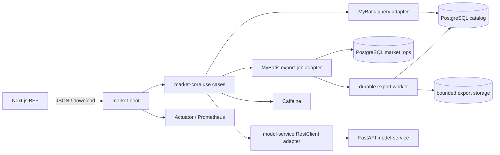
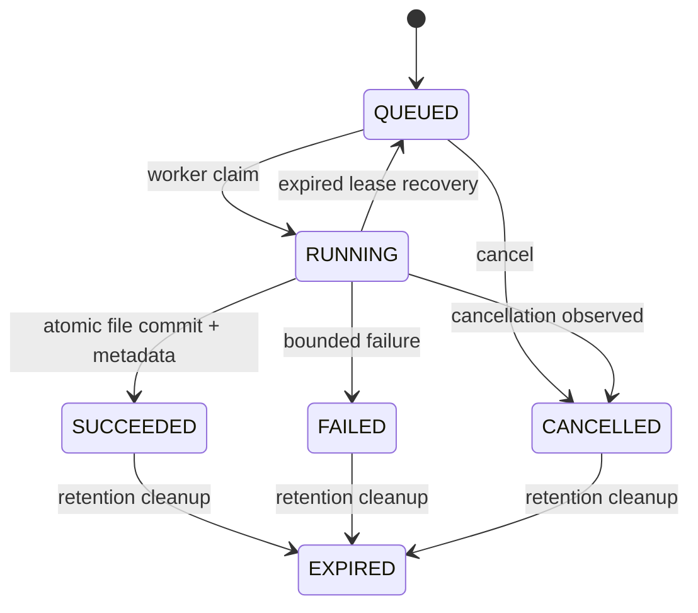

# Property Market Analysis - Spring Boot Technical Design

## 1. Purpose and scope

This document defines the target implementation for the Java `market-service`. It covers:

- contract-first API development with an OpenAPI YAML specification;
- Maven compile-time generation of Spring MVC API interfaces and DTOs;
- hand-written controller adapters that implement the generated interfaces;
- Spring Boot 3.4.4, Java 21, MyBatis, and PostgreSQL data access;
- property queries, aggregate statistics, and model-backed what-if analysis;
- asynchronous CSV/PDF generation, status polling, and streamed downloads;
- caching, configuration, errors, observability, security, testing, and CI;
- Maven module, Java package, and source-tree organization.

The source requirements are in [`Interview Tasks Fullstack.pdf`](../requirements/Interview%20Tasks%20Fullstack.pdf). The PDF directly requires the Java backend to expose REST APIs, calculate aggregate statistics from the housing dataset, integrate with the ML model container, and use caching. CSV/PDF export and sortable/filterable tables are requirements of the same Property Market Analysis application and therefore require matching backend capabilities.

Detailed business semantics remain aligned with [`requirements.md`](requirements.md), [`architecture.md`](architecture.md), and [`data-schema.md`](data-schema.md).

This is a target-state design, not a claim that the current service has already been migrated. The current `market-service` is a working v1 prototype: a single Maven module with a hand-written controller, `JdbcTemplate`, synchronous in-memory exports, and runtime-generated OpenAPI. Section 18 defines the migration path.

The complete v2 contract draft is stored in [`openapi/market-service-v2.yaml`](openapi/market-service-v2.yaml). It is under `docs/` because this deliverable was requested there. During implementation, move it to `market-contract/src/main/openapi/market-service.yaml` and retain only one authoritative copy.

## 2. Architecture decisions

| Topic | Decision |
| --- | --- |
| Deployment shape | One independently deployable Spring Boot modular monolith; do not split the Java backend into microservices |
| Web stack | Spring MVC with a blocking request model; the database and current model API are blocking, so WebFlux adds no value |
| API workflow | Contract first; YAML is the only source of truth; generate interfaces and DTOs, then implement the interfaces manually |
| Data access | MyBatis with PostgreSQL; explicit SQL, explicit result maps, and tests against the real PostgreSQL dialect |
| Pagination | Keyset/cursor pagination; do not use deep `OFFSET` pagination |
| Aggregation | Execute in PostgreSQL; never aggregate the complete dataset in the browser or Java heap |
| Exports | `POST` creates a durable asynchronous job; separate status and streamed-content endpoints |
| Files | Write CSV/PDF to controlled `.part` files and atomically commit them; PostgreSQL stores metadata only |
| Cache | Local Caffeine for bounded, reconstructible statistics and hot first pages; never cache export files |
| Model integration | Spring `RestClient` with strict connection and response deadlines; failures affect only what-if analysis |
| Database migrations | Continue using the repository-level one-shot migration container; application startup never changes the schema |
| Numeric precision | Represent money and fixed-scale decimals as JSON strings; use `BigDecimal` and PostgreSQL `numeric` internally |
| Runtime target | Optimize for the local interview environment while preserving clean replacement points for multi-instance deployment |

Spring Boot recommends locating the main application class in a root package above the rest of the application and organizing code around domains. This design places `MarketApplication` in `com.hsbc.market`, with business capabilities organized beneath that root. [Spring Boot - Structuring Your Code](https://docs.spring.io/spring-boot/3.4/reference/using/structuring-your-code.html)

## 3. Target runtime architecture



Responsibilities:

1. `market-boot` owns HTTP handling, request validation, correlation IDs, and exception-to-contract mapping.
2. `market-core` owns use cases, business rules, query normalization, fingerprints, and port definitions.
3. `market-adapters` implements database, model-service, file-storage, and report-generation ports.
4. PostgreSQL `catalog` remains the source of truth for versioned housing data. The new `market_ops` schema stores export job state only.
5. Export content never goes into PostgreSQL. The local demonstration uses a persistent volume; a multi-instance deployment replaces `ExportStorage` with object storage.

## 4. Maven modules and dependency direction

Target source tree:

```text
market-service/
├── pom.xml                         # aggregator, versions, quality plugins
├── market-contract/
│   ├── pom.xml
│   └── src/main/openapi/
│       └── market-service.yaml     # authoritative HTTP contract
├── market-core/
│   ├── pom.xml
│   └── src/
│       ├── main/java/com/hsbc/market/
│       │   ├── domain/
│       │   │   ├── model/
│       │   │   ├── query/
│       │   │   └── error/
│       │   └── application/
│       │       ├── usecase/
│       │       ├── port/in/
│       │       └── port/out/
│       └── test/java/com/hsbc/market/
├── market-adapters/
│   ├── pom.xml
│   └── src/
│       ├── main/java/com/hsbc/market/adapter/
│       │   ├── persistence/mybatis/
│       │   │   ├── mapper/query/
│       │   │   ├── mapper/export/
│       │   │   ├── record/
│       │   │   ├── typehandler/
│       │   │   ├── sql/
│       │   │   └── MyBatisMarketRepository.java
│       │   ├── modelclient/
│       │   └── export/
│       │       ├── csv/
│       │       ├── pdf/
│       │       ├── storage/
│       │       └── worker/
│       ├── main/resources/mybatis/
│       │   ├── query/MarketQueryMapper.xml
│       │   └── export/ExportJobMapper.xml
│       └── test/java/com/hsbc/market/adapter/
└── market-boot/
    ├── pom.xml
    └── src/
        ├── main/java/com/hsbc/market/
        │   ├── MarketApplication.java
        │   ├── api/
        │   │   ├── PropertiesApiController.java
        │   │   ├── StatisticsApiController.java
        │   │   ├── ExportsApiController.java
        │   │   ├── WhatIfApiController.java
        │   │   ├── ApiModelMapper.java
        │   │   └── GlobalExceptionHandler.java
        │   ├── config/
        │   │   ├── MarketProperties.java
        │   │   ├── DataSourceConfiguration.java
        │   │   ├── MyBatisConfiguration.java
        │   │   ├── CacheConfiguration.java
        │   │   ├── HttpClientConfiguration.java
        │   │   └── ExportWorkerConfiguration.java
        │   └── observability/
        ├── main/resources/
        │   ├── application.yml
        │   ├── application-local.yml
        │   └── logback-spring.xml
        └── test/java/com/hsbc/market/
```

Dependencies remain one-way:

```text
market-contract ───────────────────────┐
                                      v
market-core <── market-adapters <── market-boot
      ^                               |
      └───────────────────────────────┘
```

- `market-core` is pure Java 21 and has no dependency on Spring, MyBatis, generated DTOs, or file libraries.
- `market-contract` contains only generated HTTP interfaces/DTOs and their minimum compile-time dependencies.
- `market-adapters` depends on `market-core` and implements output ports; it does not depend on `market-contract`.
- `market-boot` depends on all modules and owns Spring wiring and contract-to-domain mapping.
- `market-core` must never return `ResponseEntity`, `Resource`, a MyBatis record, or an OpenAPI-generated class.

This structure preserves domain boundaries without creating meaningless Manager/Service/DAO chains for simple calls.

## 5. Technology baseline

| Category | Selection | Version or rule |
| --- | --- | --- |
| JDK | Java | 21; Maven compiler `release=21` |
| Framework | Spring Boot | 3.4.4, fixed by the source PDF |
| Web | `spring-boot-starter-web` | Spring MVC and Tomcat |
| Validation | `spring-boot-starter-validation` | Jakarta Bean Validation |
| SQL | MyBatis Spring Boot Starter | 3.0.4; its release baseline is Spring Boot 3.4.x |
| Database | PostgreSQL JDBC | Version managed by the Spring Boot BOM; PostgreSQL 17.x |
| Pool | HikariCP | Spring Boot default; version managed by the BOM |
| Contract generation | OpenAPI Generator Maven Plugin | Pin 7.12.0; upgrades require review of generated diffs |
| API UI | springdoc Swagger UI | 2.8.6; displays source YAML rather than deriving another contract |
| Cache | Spring Cache and Caffeine | Caffeine 3.1.x; centrally managed |
| HTTP client | Spring `RestClient` | Constructed from Boot's `RestClient.Builder` |
| PDF | OpenPDF | 2.0.3 with a server-owned versioned template |
| CSV | Apache Commons CSV or a tested streaming writer | RFC 4180 UTF-8 output |
| Observability | Actuator, Micrometer, Prometheus | Versions managed by the Boot BOM |
| Testing | JUnit 5, AssertJ, MockMvc, Testcontainers, MyBatis Test | PostgreSQL 17 container; do not substitute H2 |

The MyBatis compatibility matrix states that the 3.0 line supports Spring Boot 3.2-3.5 and Java 17 or later; release 3.0.4 specifically moved its baseline to Spring Boot 3.4.x. [MyBatis Spring Boot Starter](https://mybatis.org/spring-boot-starter/mybatis-spring-boot-autoconfigure/index.html) / [3.0.4 release](https://github.com/mybatis/spring-boot-starter/releases/tag/mybatis-spring-boot-3.0.4)

Dependency rules:

- Do not override versions for Spring, Jackson, Micrometer, Testcontainers, or other dependencies managed by the Spring Boot BOM.
- Pin MyBatis Starter, OpenAPI Generator, springdoc, and OpenPDF in the parent POM.
- Commit Maven Wrapper and run only `./mvnw` in CI; do not depend on a globally installed Maven.
- Use Maven Enforcer for Java 21, dependency convergence, and duplicate-class detection.

## 6. Contract-first OpenAPI generation

### 6.1 Single source of truth

The implementation-time source file is:

```text
market-contract/src/main/openapi/market-service.yaml
```

Rules:

- Change endpoints, methods, parameters, status codes, headers, media types, enums, and validation bounds in YAML before changing Java.
- Each operation has exactly one business tag. With `useTags=true`, generation produces `PropertiesApi`, `StatisticsApi`, `ExportsApi`, and `WhatIfApi`.
- Every operation has a stable, unique `operationId`.
- Generated files live under `target/generated-sources/openapi`, are not committed, and are never edited manually.
- Generated classes are HTTP-boundary types only. The domain layer owns separate immutable records and value objects.
- The contract uses OpenAPI 3.1.0. If the pinned generator cannot handle a new 3.1 keyword, CI fails; validation must not be skipped.

The OpenAPI Generator Spring generator is a stable server generator and supports `interfaceOnly`, `useSpringBoot3`, `useTags`, `useBeanValidation`, and `skipDefaultInterface`. [Spring generator options](https://openapi-generator.tech/docs/generators/spring/)

### 6.2 Key `market-contract/pom.xml` configuration

```xml
<properties>
    <openapi-generator.version>7.12.0</openapi-generator.version>
</properties>

<dependencies>
    <dependency>
        <groupId>org.springframework</groupId>
        <artifactId>spring-web</artifactId>
    </dependency>
    <dependency>
        <groupId>org.springframework</groupId>
        <artifactId>spring-context</artifactId>
    </dependency>
    <dependency>
        <groupId>org.hibernate.validator</groupId>
        <artifactId>hibernate-validator</artifactId>
    </dependency>
    <dependency>
        <groupId>jakarta.annotation</groupId>
        <artifactId>jakarta.annotation-api</artifactId>
    </dependency>
    <dependency>
        <groupId>jakarta.servlet</groupId>
        <artifactId>jakarta.servlet-api</artifactId>
        <scope>provided</scope>
    </dependency>
    <dependency>
        <groupId>com.fasterxml.jackson.core</groupId>
        <artifactId>jackson-annotations</artifactId>
    </dependency>
    <dependency>
        <groupId>com.fasterxml.jackson.core</groupId>
        <artifactId>jackson-databind</artifactId>
    </dependency>
</dependencies>

<build>
    <plugins>
        <plugin>
            <groupId>org.openapitools</groupId>
            <artifactId>openapi-generator-maven-plugin</artifactId>
            <version>${openapi-generator.version}</version>
            <executions>
                <execution>
                    <id>generate-market-api</id>
                    <phase>generate-sources</phase>
                    <goals><goal>generate</goal></goals>
                    <configuration>
                        <inputSpec>${project.basedir}/src/main/openapi/market-service.yaml</inputSpec>
                        <generatorName>spring</generatorName>
                        <library>spring-boot</library>
                        <output>${project.build.directory}/generated-sources/openapi</output>
                        <apiPackage>com.hsbc.market.contract.api</apiPackage>
                        <modelPackage>com.hsbc.market.contract.model</modelPackage>
                        <invokerPackage>com.hsbc.market.contract</invokerPackage>
                        <skipValidateSpec>false</skipValidateSpec>
                        <generateApiTests>false</generateApiTests>
                        <generateModelTests>false</generateModelTests>
                        <generateSupportingFiles>false</generateSupportingFiles>
                        <configOptions>
                            <sourceFolder>src/main/java</sourceFolder>
                            <interfaceOnly>true</interfaceOnly>
                            <useTags>true</useTags>
                            <useSpringBoot3>true</useSpringBoot3>
                            <useResponseEntity>true</useResponseEntity>
                            <useBeanValidation>true</useBeanValidation>
                            <performBeanValidation>true</performBeanValidation>
                            <skipDefaultInterface>true</skipDefaultInterface>
                            <openApiNullable>false</openApiNullable>
                            <documentationProvider>none</documentationProvider>
                            <annotationLibrary>none</annotationLibrary>
                            <hideGenerationTimestamp>true</hideGenerationTimestamp>
                            <dateLibrary>java8</dateLibrary>
                            <enumPropertyNaming>MACRO_CASE</enumPropertyNaming>
                            <disallowAdditionalPropertiesIfNotPresent>false</disallowAdditionalPropertiesIfNotPresent>
                        </configOptions>
                    </configuration>
                </execution>
            </executions>
        </plugin>
    </plugins>
</build>
```

The OpenAPI Generator Maven plugin binds naturally to `generate-sources`, so `./mvnw clean verify` validates YAML, generates code, and compiles it in one build. Never set `skipValidateSpec=true`. [OpenAPI Generator Maven plugin](https://openapi-generator.tech/docs/plugins/)

### 6.3 Implementing generated interfaces

Generated code defines the HTTP signature. A controller performs protocol adaptation only:

```java
@RestController
final class StatisticsApiController implements StatisticsApi {
    private final QueryStatisticsUseCase useCase;
    private final ApiModelMapper mapper;

    StatisticsApiController(QueryStatisticsUseCase useCase, ApiModelMapper mapper) {
        this.useCase = useCase;
        this.mapper = mapper;
    }

    @Override
    public ResponseEntity<StatisticsResponse> queryStatistics(
            StatisticsQuery request,
            UUID xCorrelationId) {
        var command = mapper.toDomain(request);
        var result = useCase.query(command);
        return ResponseEntity.ok(mapper.toContract(result));
    }
}
```

Constraints:

- The implementation does not repeat `@RequestMapping`, HTTP methods, paths, or validation annotations.
- Controllers never access a Mapper, `SqlSession`, file system, or `RestClient` directly.
- `ApiModelMapper` performs explicit conversions, especially `String <-> BigDecimal`, enums, and UTC timestamps.
- Do not use reflection-based universal bean copying. Explicit mappings make contract changes fail at compile time.
- A generator upgrade must regenerate and compile every implementation in the same `clean verify` run.

### 6.4 Swagger UI and contract publication

Copy the source YAML into `META-INF/resources/openapi/market-service.yaml` in the `market-contract` JAR. Spring Boot then publishes it as a static resource:

```yaml
springdoc:
  api-docs:
    enabled: false
  swagger-ui:
    url: /openapi/market-service.yaml
    path: /swagger-ui.html
```

Swagger UI therefore displays the exact build input instead of deriving a second specification from implementation annotations. A runtime smoke test should confirm that `/openapi/market-service.yaml` has the same SHA-256 as the source contract.

## 7. REST API design

The complete schemas, parameters, headers, and responses are in the companion YAML.

| Capability | Method and path | Execution model |
| --- | --- | --- |
| Property records | `GET /api/v2/market/properties` | Synchronous keyset page |
| Statistics and charts | `POST /api/v2/market/statistics/query` | Synchronous bounded aggregation |
| Create export | `POST /api/v2/market/exports` | `202 Accepted` |
| Export status | `GET /api/v2/market/exports/{export_id}` | Synchronous status read |
| File download | `GET /api/v2/market/exports/{export_id}/content` | Streamed file |
| Cancel or clean up | `DELETE /api/v2/market/exports/{export_id}` | Idempotent cancellation |
| What-if analysis | `POST /api/v2/market/what-if` | Synchronous model call |

### 7.1 HTTP conventions

- JSON and query parameter names use `snake_case`. Generated Java properties use camelCase with Jackson mappings.
- Every success and error response returns `X-Correlation-ID`. An invalid client-provided UUID returns `400 INVALID_CORRELATION_ID`.
- Timestamps use ISO-8601 UTC, for example `2026-10-19T00:00:00Z`.
- Money is a fixed two-decimal string in JSON; Java and PostgreSQL use `BigDecimal` and `numeric(18,2)`.
- When a client omits the dataset version, resolve the active version once at the start of the request. Every SQL statement, cache key, and export job uses that UUID and content hash.
- `/properties` returns at most 200 records and does not hide a full `COUNT(*)`. Clients request an exact count through the statistics API.
- A cursor contains the version, normalized query fingerprint, final sort value, and `source_id`. Encode it with Base64URL and sign it with HMAC-SHA256.
- Export creation requires a UUID `Idempotency-Key`. Reusing the same key with the same canonical payload returns the original job; a different payload returns `409 IDEMPOTENCY_KEY_REUSED`.

### 7.2 Error contract

Every business error uses `ApiErrorResponse`:

```json
{
  "error": {
    "code": "INVALID_FILTER",
    "message": "price.gte cannot exceed price.lte",
    "fields": [
      {"field": "filters.price", "message": "minimum cannot exceed maximum"}
    ]
  },
  "correlation_id": "0f768492-4448-40ce-a86a-c21ddfd7307f"
}
```

`@RestControllerAdvice` mapping:

| Failure | HTTP | Example code |
| --- | --- | --- |
| Parameter binding or JSON syntax | 400 | `MALFORMED_REQUEST` |
| Bean Validation or business validation | 422 | `VALIDATION_ERROR` |
| Dataset or export not found | 404 | `RESOURCE_NOT_FOUND` |
| Cursor/query or idempotency conflict | 409 | `QUERY_STATE_MISMATCH` |
| Export concurrency or capacity limit | 429 | `CAPACITY_EXCEEDED` |
| Model service timeout or unavailability | 503 | `MODEL_SERVICE_UNAVAILABLE` |
| Unexpected failure | 500 | `INTERNAL_ERROR`; log the stack trace but never expose internals |

## 8. Domain and application layers

Recommended input ports:

```java
public interface ListPropertiesUseCase {
    PropertySlice list(NormalizedMarketQuery query);
}

public interface QueryStatisticsUseCase {
    StatisticsResult query(StatisticsCommand command);
}

public interface ExportUseCase {
    ExportJob create(CreateExportCommand command);
    ExportJob get(UUID exportId);
    void cancel(UUID exportId);
    ExportContent locateContent(UUID exportId);
}

public interface WhatIfUseCase {
    WhatIfResult predict(PropertyFeatures features, CorrelationId correlationId);
}
```

Recommended output ports:

```java
public interface MarketReadPort { /* resolve version, list, aggregate, stream */ }
public interface ExportJobPort { /* insert, claim, transition, cancel, expire */ }
public interface PredictionPort { Prediction predict(PropertyFeatures input); }
public interface ExportStorage { /* create temp, commit, open, delete */ }
public interface CsvExportPort { ExportArtifact generate(...); }
public interface PdfExportPort { ExportArtifact generate(...); }
```

Normalize and validate these invariants before calling adapters:

- a range minimum cannot exceed its maximum;
- metric IDs are unique and each request contains 1-20 metrics;
- method/field combinations are valid, including the special `COUNT(*)` case;
- high-cardinality grouping requires a fixed-width bucket;
- a request has at most one client sort field, followed by `source_id` in the same direction;
- PDF detail limit is at most 5000; that limit does not apply to CSV;
- a CSV request cannot contain PDF options;
- fixed-scale decimals are exactly representable before SQL or model calls; do not silently round them.

## 9. MyBatis data access

### 9.1 Starter and base configuration

`market-adapters` uses:

```xml
<dependency>
    <groupId>org.mybatis.spring.boot</groupId>
    <artifactId>mybatis-spring-boot-starter</artifactId>
    <version>3.0.4</version>
</dependency>
<dependency>
    <groupId>org.postgresql</groupId>
    <artifactId>postgresql</artifactId>
    <scope>runtime</scope>
</dependency>
```

Base settings:

```yaml
mybatis:
  mapper-locations: classpath*:mybatis/**/*.xml
  type-aliases-package: com.hsbc.market.adapter.persistence.mybatis.record
  configuration:
    map-underscore-to-camel-case: true
    local-cache-scope: statement
    cache-enabled: false
    default-statement-timeout: 3
    jdbc-type-for-null: 'NULL'
```

The MyBatis starter can create `SqlSessionFactory` and `SqlSessionTemplate` from a `DataSource` and scan Mapper interfaces. Because this design uses two connection budgets, configure two factories/templates explicitly; do not mix manual multi-source configuration with assumptions from single-source auto-configuration. [MyBatis auto-configuration](https://mybatis.org/spring-boot-starter/mybatis-spring-boot-autoconfigure/index.html)

### 9.2 Separate connection budgets

| Pool | Purpose | Initial capacity | SQL timeout |
| --- | --- | --- | --- |
| `marketQueryDataSource` | Pages, statistics, version resolution, job status | max 8, min idle 1, connection timeout 2s | 3s |
| `marketExportDataSource` | Export streaming and workers | max 2, min idle 0, connection timeout 2s | 120s |

Both pools may use the same restricted `market_runtime` login while keeping Mapper packages and connection budgets separate. The current role is read-only, so migration V006 must grant only the required `SELECT/INSERT/UPDATE/DELETE` permissions on `market_ops.export_jobs`, while preserving read-only access to `catalog`.

### 9.3 Mapper boundary

- Mapper interfaces are infrastructure details, not application-layer repositories.
- Mapper methods accept explicit parameter objects, not anonymous `Map<String,Object>` values.
- SQL records and domain models are separate; the repository adapter converts between them.
- List every selected column; never use `SELECT *`.
- Use native JDBC support for `BigDecimal`, `UUID`, and `Instant/OffsetDateTime`; add a TypeHandler only for a demonstrated gap.
- Every complex query has SQL-provider/XML tests and a PostgreSQL integration test.

Example:

```java
@Mapper
public interface MarketQueryMapper {
    DatasetVersionRecord findDatasetVersion(UUID requestedVersionId);
    List<PropertyRecord> selectPage(PropertyPageParameters parameters);
    List<StatisticRowRecord> selectStatistics(StatisticsSqlParameters parameters);
    void streamForExport(ExportQueryParameters parameters,
                         ResultHandler<PropertyRecord> resultHandler);
}
```

### 9.4 Safe dynamic SQL

Bind all ordinary values with `#{value}`. JDBC cannot bind identifiers, ordering keywords, or aggregate function names. Handle these tokens in one of two ways:

1. XML `<choose>` maps a domain enum to a static SQL fragment; or
2. `StatisticsSqlProvider` uses an exhaustive `switch` over sealed enums and server-owned constants.

Never:

- pass raw query/body strings into `${column}`, `${direction}`, or `${method}`;
- assemble SQL in controllers or services;
- accept arbitrary client expressions;
- silently fall back to a default column for an unknown OpenAPI enum value.

Pagination XML explicitly enumerates every field and direction:

```xml
<choose>
  <when test="sortField.name() == 'PRICE' and direction.name() == 'ASC'">
    AND (price, source_id) &gt; (#{lastDecimalValue}, #{lastSourceId})
    ORDER BY price ASC, source_id ASC
  </when>
  <when test="sortField.name() == 'PRICE' and direction.name() == 'DESC'">
    AND (price, source_id) &lt; (#{lastDecimalValue}, #{lastSourceId})
    ORDER BY price DESC, source_id DESC
  </when>
  <!-- Enumerate the remaining allow-listed fields in the same manner. -->
</choose>
LIMIT #{limitPlusOne}
```

The first page omits the keyset predicate. Fetch `limit + 1` records to calculate `has_more`, and return at most `limit`.

### 9.5 Transactions

- Interactive query: `@Transactional(readOnly = true, timeout = 3)`; resolve one dataset version and execute the request SQL within that boundary.
- Create export: short write transaction that normalizes the request, verifies the idempotency key, inserts a `QUEUED` job, and commits. Never generate a file in this transaction.
- Worker claim: short write transaction using `FOR UPDATE SKIP LOCKED`, followed by a lease write.
- File generation: outside the database transaction.
- Worker completion: short write transaction that checks owner/revision and changes `RUNNING` to `SUCCEEDED`.
- Download: read successful job metadata, then open the file without holding a database transaction across the network response.
- Cancellation: set `cancel_requested=true`; the worker checks it between database batches and while writing.

### 9.6 Export job table

Add `V006__create_market_export_jobs.sql` with the following core structure:

```sql
CREATE SCHEMA market_ops;

CREATE TABLE market_ops.export_jobs (
    export_id uuid PRIMARY KEY,
    idempotency_key uuid NOT NULL UNIQUE,
    request_sha256 char(64) NOT NULL,
    request_payload jsonb NOT NULL,
    dataset_version_id uuid NOT NULL
        REFERENCES catalog.dataset_versions(dataset_version_id),
    query_fingerprint varchar(71) NOT NULL,
    format varchar(3) NOT NULL CHECK (format IN ('CSV', 'PDF')),
    status varchar(16) NOT NULL CHECK (status IN (
        'QUEUED', 'RUNNING', 'SUCCEEDED', 'FAILED', 'CANCELLED', 'EXPIRED'
    )),
    state_revision bigint NOT NULL DEFAULT 0,
    cancel_requested boolean NOT NULL DEFAULT false,
    lease_owner varchar(128),
    lease_expires_at timestamptz,
    created_at timestamptz NOT NULL DEFAULT now(),
    started_at timestamptz,
    completed_at timestamptz,
    expires_at timestamptz NOT NULL,
    row_count bigint,
    detail_row_count bigint,
    details_truncated boolean,
    content_key text,
    content_type varchar(64),
    content_length bigint,
    content_sha256 char(64),
    failure_code varchar(64),
    failure_summary varchar(512)
);

CREATE INDEX export_jobs_claim_idx
    ON market_ops.export_jobs (status, created_at)
    WHERE status = 'QUEUED';
CREATE INDEX export_jobs_expiry_idx
    ON market_ops.export_jobs (expires_at)
    WHERE status IN ('SUCCEEDED', 'FAILED', 'CANCELLED');
```

`content_key` is a storage-adapter-generated relative key, never a user path. Error summaries must not contain SQL, credentials, absolute paths, or complete request payloads.

## 10. CSV/PDF generation and downloads

### 10.1 State machine



After a restart, a `RUNNING` job with an expired lease returns safely to `QUEUED`. `state_revision` prevents an old worker from overwriting a newer worker's result.

### 10.2 File commit protocol

1. `ExportStorage.createTemp(exportId)` creates a random `.part` file beneath a controlled root.
2. The generator reads a PostgreSQL cursor, writes incrementally, and calculates SHA-256 and byte count at the same time.
3. It checks cancellation, row, byte, and runtime limits.
4. After close/fsync, it atomically moves the file to an immutable final key on the same file system.
5. A database transaction changes the job to `SUCCEEDED` and writes hash, length, and content type.
6. If database commit fails, delete the orphaned final file. If generation fails, delete the `.part` file.

Initial protection limits:

| Protection | Initial value |
| --- | --- |
| Concurrent exports | 2 |
| Waiting queue | 20; return 429 when full |
| CSV maximum rows | Configurable; initially 1,000,000 |
| Maximum file size | 512 MiB |
| Maximum task runtime | 120 seconds |
| PDF detail rows | Default 500, maximum 5000 |
| Retention | 24 hours |

### 10.3 CSV

- UTF-8, RFC 4180, CRLF line endings, fixed header order.
- Data order exactly matches the effective selection sort.
- Price has two decimals; bathrooms one; distance and school rating three.
- Current columns are numeric and cannot trigger spreadsheet formulas. If text columns are added, define and test a policy for values beginning with `=`, `+`, `-`, or `@`.
- Use a MyBatis cursor/`ResultHandler` and JDBC fetch size of 1000. Never load the full result into a `List`.

### 10.4 PDF

- OpenPDF server template `market-analysis-v1`, A4 landscape.
- Include title, UTC generation time, dataset version/hash, filters, statistics, charts, optional what-if data, and a detail-truncation statement.
- Repeat table headers across pages and include page numbers.
- Generate charts on the server; never accept client HTML, scripts, fonts, or templates.
- Package fonts in the application and verify them in the container; do not depend on host fonts.
- When details exceed the limit, state `Showing first N of M records`. CSV remains the complete machine-readable export.

### 10.5 Download implementation

The contract declares the response body as `type: string, format: binary`. Return a `Resource`, never a `byte[]`:

```java
@Override
public ResponseEntity<Resource> downloadExport(UUID exportId, UUID correlationId) {
    ExportContent content = exportUseCase.locateContent(exportId);
    Resource resource = storage.asResource(content.storageKey());

    return ResponseEntity.ok()
            .contentType(MediaType.parseMediaType(content.contentType()))
            .contentLength(content.length())
            .header(HttpHeaders.CONTENT_DISPOSITION,
                    ContentDisposition.attachment()
                            .filename(content.safeFilename(), StandardCharsets.UTF_8)
                            .build().toString())
            .header("Content-Digest", content.sha256ContentDigest())
            .eTag('"' + content.sha256() + '"')
            .cacheControl(CacheControl.noStore())
            .header("X-Content-Type-Options", "nosniff")
            .body(resource);
}
```

Validation order: the job is visible to the current access scope, its state is `SUCCEEDED`, it has not expired, metadata is complete, the file exists, and its length matches. Return 409 for `QUEUED/RUNNING/FAILED/CANCELLED`, 410 for expired content, and 404 for an unknown ID.

## 11. Model-service integration

Implement `PredictionPort` with Spring `RestClient`:

- Build it from the auto-configured `RestClient.Builder` to preserve Micrometer observations and trace propagation. Spring Boot notes that directly creating the client bypasses automatic trace propagation. [Spring Boot tracing](https://docs.spring.io/spring-boot/3.4/reference/actuator/tracing.html)
- Use a one-second connection timeout, a three-second total response timeout, and a bounded response body.
- Propagate `X-Correlation-ID`.
- Call `POST /api/v1/predict` with exactly one property and require exactly one non-null prediction in the response.
- Preserve stable downstream validation codes for 4xx responses. Convert connection failures, timeouts, and invalid 2xx payloads to `503 MODEL_SERVICE_UNAVAILABLE`.
- Do not retry by default. Even though prediction is currently side-effect-free, retries can amplify failures in the demonstration environment.
- Use an independent semaphore/bulkhead. Model failures must not consume the capacity reserved for market queries and export workers.

Spring Framework defines `RestClient` as a synchronous fluent HTTP client and also supports interface-based HTTP Service clients. With one small downstream operation, a direct adapter around `RestClient` is clearer. [Spring REST clients](https://docs.spring.io/spring-framework/reference/6.2/integration/rest-clients.html)

## 12. Cache design

Cache:

- bounded statistics responses;
- frequently requested first pages without cursors;
- active dataset version resolution with a short TTL.

Do not cache:

- later cursor pages;
- complete export results or files;
- failures;
- model what-if results;
- mutable export job states.

Every cache key includes API major version, dataset content SHA-256, normalized filters, sort, metrics, grouping, ordering, and limit. Any input that is not part of the key must not affect the result.

Suggested caches:

| Cache | Maximum size | TTL |
| --- | ---: | ---: |
| `statistics` | 500 | 5 minutes |
| `firstPage` | 200 | 60 seconds |
| `datasetVersion` | 8 | 30 seconds |

Place `@EnableCaching` in a dedicated `CacheConfiguration`, not on `MarketApplication`. Spring Boot warns that placing it on the main application class makes caching mandatory in every test. [Spring Boot caching](https://docs.spring.io/spring-boot/3.4/reference/io/caching.html)

Expose cache loads, hits, misses, evictions, and load latency through Micrometer. Caffeine is a reconstructible performance optimization; eviction and service restarts must never change correctness.

## 13. Configuration and startup

Use immutable `@ConfigurationProperties` records with `@Validated` instead of scattered `@Value` fields:

```java
@ConfigurationProperties("market")
@Validated
public record MarketProperties(
        @Valid Database database,
        @Valid ModelService modelService,
        @Valid Export export,
        @Valid Cache cache,
        @Valid Cursor cursor) {
    // Nested records use @NotNull, @Min, and Duration constraints.
}
```

Spring Boot recommends grouping application-specific settings in type-safe, validated `@ConfigurationProperties` objects. [Externalized configuration](https://docs.spring.io/spring-boot/3.4/reference/features/external-config.html)

Suggested keys:

```yaml
market:
  database:
    query-timeout: 3s
    export-timeout: 120s
  model-service:
    base-url: ${MODEL_SERVICE_URL:http://localhost:8000}
    connect-timeout: 1s
    response-timeout: 3s
    max-concurrency: 8
  export:
    root: ${MARKET_EXPORT_ROOT:/var/lib/market-service/exports}
    workers: 2
    queue-capacity: 20
    retention: 24h
    max-bytes: 512MB
    max-runtime: 120s
  cursor:
    hmac-secret: ${MARKET_CURSOR_HMAC_SECRET}
```

Fail startup when a required secret is missing, the export root is not writable, a database pool cannot initialize, or the database schema is incompatible. Model-service unavailability must not block startup or readiness; only what-if requests return 503.

Leave Java 21 virtual threads disabled initially. JDBC concurrency remains bounded by Hikari, and exports already have explicit workers. Enable virtual threads only after load tests demonstrate a benefit.

## 14. Health, observability, and logging

### 14.1 Health

- `/actuator/health/liveness` reports whether this JVM can continue running. It does not check PostgreSQL, model-service, or external storage.
- `/actuator/health/readiness` checks database connectivity, readable catalog data, writable `market_ops`, and available export storage.
- Publish model-service status as a separate health component and metric, but do not include it in overall readiness. Market queries, statistics, and completed downloads remain useful when prediction is unavailable.
- Optionally enable `management.endpoint.health.probes.add-additional-paths=true` to expose `/livez` and `/readyz` on the main port.

Spring Boot's Actuator guidance similarly states that liveness should not depend on external systems because external failures could otherwise trigger cascading restarts. [Actuator endpoints and probes](https://docs.spring.io/spring-boot/3.4/reference/actuator/endpoints.html)

### 14.2 Metrics

Provide at least:

- HTTP latency and errors by operationId/status;
- database query duration, timeouts, and returned rows;
- statistics duration and group count;
- cache hit, miss, load, and eviction counts;
- model-client latency, status, timeout, and bulkhead rejection;
- export queued/running/succeeded/failed/cancelled counts, queue age, generation duration, rows, and bytes;
- Hikari active, idle, and pending connections;
- JVM, GC, CPU, and export-disk free space.

Never use export ID, correlation ID, cursor, or complete filter expressions as metric tags.

### 14.3 Logging

Structured JSON/key-value fields should include `timestamp`, `level`, `service`, `trace_id`, `correlation_id`, `operation`, `dataset_version_id`, `query_fingerprint`, `duration_ms`, and `outcome`. Never log database passwords, complete requests, download paths, decoded cursors, or stack traces in HTTP responses.

## 15. Security and capacity protection

- In the account-free interview environment, expose the Java service only through the Compose network and Next.js BFF. Any direct host binding uses `127.0.0.1`.
- If the browser does not call Java directly, remove broad CORS. If direct calls are required, allow only the configured portal origin and required methods/headers.
- Expose only `health`, `prometheus`, and `metrics` Actuator endpoints, and keep the management surface internal.
- Use least-privilege database roles. The application can never modify `catalog`.
- Bound every body, array, string, page, metric, group, queue, file, and runtime dimension.
- Read the HMAC cursor secret from an environment variable or secret mount and never print it.
- Generate filenames and extensions from server-owned allow-lists. Clients never submit a path.
- Downloads use `Content-Disposition: attachment`, `X-Content-Type-Options: nosniff`, the exact media type and length, a digest, and `Cache-Control: no-store`.
- Scan dependencies regularly. Security remediation must not silently change the Spring Boot version fixed by the source task; document any compatibility patch strategy.

## 16. Test strategy

### 16.1 Test layers

| Layer | Tooling | Required coverage |
| --- | --- | --- |
| Contract static checks | OpenAPI Generator validate/compile | Valid YAML, resolvable `$ref`, unique operationId, compilable generated code |
| Domain unit tests | JUnit 5 and AssertJ | Filters, metrics, buckets, decimal rules, fingerprints, cursors, state machine |
| Web slice | `@WebMvcTest` and MockMvc | Generated-interface binding, status/header/media type, error contract |
| MyBatis slice | `@MybatisTest` and PostgreSQL Testcontainers | XML/provider SQL, result maps, transactions, types, permissions |
| Model adapter | WireMock or MockWebServer | Timeouts, 4xx/5xx, invalid bodies, header propagation |
| Integration | `@SpringBootTest` and Testcontainers | API -> MyBatis -> PostgreSQL, job worker -> storage |
| File golden tests | PDF render and CSV parser | Headers, values, pages, fonts, hashes, row count, truncation statement |
| End-to-end | Compose and portal/HTTP | Table/statistics/export use identical filters and dataset version |
| Performance | Dedicated profile | Million-row fixture, cursor paging, aggregation, CSV heap behavior, capacity isolation |

Spring Boot 3.4 Testcontainers service connections can provide container connection details automatically when `spring-boot-testcontainers` is present. [Spring Boot Testcontainers](https://docs.spring.io/spring-boot/3.4/reference/testing/testcontainers.html)

### 16.2 Critical acceptance tests

1. All nine sort fields page without duplicates or gaps, including duplicate sort values resolved by `source_id`.
2. A tampered cursor, a cursor from another dataset, or a cursor reused after changing filters is rejected.
3. Table, statistics, CSV, and PDF use exactly the same normalized filters and dataset version.
4. Multiple metrics execute in one SQL statement. An empty scope returns `COUNT=0`; other aggregates are null in the domain and omit `StatisticValue.value` in the response.
5. SQL injection strings cannot cross enum/identifier boundaries into a Mapper.
6. CSV heap usage does not grow linearly with result size; client disconnect or cancellation stops work.
7. Multi-page PDF output repeats headers, includes correct page numbers, renders fonts correctly, and declares truncation.
8. Concurrent creation with one idempotency key produces one job. Reuse with another payload returns 409.
9. A worker crash after claim is recoverable after lease expiry and cannot produce two committed results.
10. Model-service failure returns 503 for what-if while properties, statistics, and completed downloads continue to work.
11. Every error returns a correlation ID; 500 responses reveal no SQL, paths, or stack traces.
12. Source YAML, Swagger UI, and compiled interfaces all originate from the same file.

## 17. Build and CI gates

Standard command:

```bash
./mvnw -B -ntp clean verify
```

CI order:

1. Verify Maven Wrapper, Java 21, and dependency convergence.
2. Validate OpenAPI and generate interfaces/DTOs.
3. Compile every module. Any unimplemented generated operation fails compilation.
4. Run formatting, static analysis, and ArchUnit module-boundary checks.
5. Run unit, web-slice, and MyBatis/PostgreSQL integration tests.
6. Run contract smoke tests and CSV/PDF golden tests.
7. Produce JaCoCo results; recommended gates are line >= 80% and branch >= 70%, with full branch coverage for state machines and query normalization.
8. Build the OCI image with a non-root user, a read-only application layer, and a separate writable export volume.
9. Run a Compose smoke test: migrate the database, start model-service and market-service, execute the v2 happy path, and verify the download hash.

Every CI build starts from `clean`. Never rely on stale generated files in a developer's `target` directory, and never commit generated source merely to hide generator or contract drift.

## 18. Migration from the current v1 prototype

| Current implementation | Target implementation |
| --- | --- |
| Classes are flat under `com.hsbc.market` | Multi-module Maven build organized by capability |
| Hand-written `MarketController` | Four implementations of generated API interfaces |
| springdoc derives JSON from annotations | Source YAML generates code and drives Swagger UI |
| `JdbcTemplate` | MyBatis Mapper/XML/provider plus repository adapters |
| `OFFSET` pagination | Signed keyset cursor |
| One `/analysis` response mixes records, statistics, charts | Separate properties and statistics APIs |
| CSV/PDF return synchronous `byte[]` | Durable asynchronous jobs plus streamed `Resource` downloads |
| Up to 5000 rows are materialized in a `List` | JDBC fetch size and streaming writer |
| No durable export state | `market_ops.export_jobs` with lease recovery |
| `@EnableCaching` on the application class | Dedicated `CacheConfiguration` |
| Scattered `@Value` fields | Validated `@ConfigurationProperties` |
| Simple model-client request factory | Boot `RestClient.Builder`, observations, and capacity isolation |

Implementation sequence:

1. Freeze current v1 behavior with tests, then add the v2 YAML and `market-contract` module.
2. Establish `market-core` models, use cases, and ports without changing v1 endpoints.
3. Replace `JdbcTemplate` with a MyBatis adapter while keeping v1 tests green.
4. Implement generated properties/statistics interfaces and keyset cursors.
5. Add migration V006, export workers, storage, and the v2 download API.
6. Move what-if behavior behind the generated interface and new model adapter.
7. Switch the Next.js BFF to v2 in one consumer release and run end-to-end tests.
8. Keep v1 for a short compatibility window. Once no consumer remains, remove the v1 controller, old DTOs, synchronous `byte[]` exports, and runtime contract generation.
9. Update [`architecture.md`](architecture.md), [`data-schema.md`](data-schema.md), Compose volumes/health checks, and the test report.

Keep `clean verify` and Compose smoke tests green at every step. Do not rewrite the contract, database access, exports, and frontend in one change.

## 19. Definition of Done

The Java backend is complete only when all of the following hold:

- YAML is the only API source, and a clean Maven build generates and compiles every interface and DTO.
- Hand-written implementations cover every operation with no default 501 response and no duplicate mapping annotations.
- Swagger UI displays source YAML, and the served contract hash matches the source file.
- MyBatis replaces `JdbcTemplate` in business paths, and every dynamic identifier is allow-listed.
- Table, statistics, CSV, and PDF produce consistent results for the same filters, sort, and dataset version.
- CSV/PDF generation and download do not use `byte[]` or a complete in-memory `List`.
- Export jobs survive restart, can be cancelled, expire cleanly, and support idempotent creation.
- What-if uses the shared model container reliably, and model failure does not degrade market reads.
- Every Caffeine key includes dataset hash and the complete normalized query; disabling cache does not change results.
- Readiness, liveness, Prometheus metrics, and correlation/trace logs support a live failure demonstration.
- PostgreSQL Testcontainers, web-slice, contract, file, and end-to-end tests pass.
- Every source-PDF requirement maps to an endpoint, automated test, or demonstration step.

## 20. References

- [Spring Boot 3.4 - Structuring Your Code](https://docs.spring.io/spring-boot/3.4/reference/using/structuring-your-code.html)
- [Spring Boot 3.4 - Externalized Configuration](https://docs.spring.io/spring-boot/3.4/reference/features/external-config.html)
- [Spring Boot 3.4 - Caching](https://docs.spring.io/spring-boot/3.4/reference/io/caching.html)
- [Spring Boot 3.4 - Actuator Endpoints and Probes](https://docs.spring.io/spring-boot/3.4/reference/actuator/endpoints.html)
- [Spring Boot 3.4 - Testcontainers](https://docs.spring.io/spring-boot/3.4/reference/testing/testcontainers.html)
- [Spring Framework 6.2 - REST Clients](https://docs.spring.io/spring-framework/reference/6.2/integration/rest-clients.html)
- [MyBatis Spring Boot Starter](https://mybatis.org/spring-boot-starter/mybatis-spring-boot-autoconfigure/index.html)
- [OpenAPI Generator Maven Plugin](https://openapi-generator.tech/docs/plugins/)
- [OpenAPI Generator Spring Options](https://openapi-generator.tech/docs/generators/spring/)
